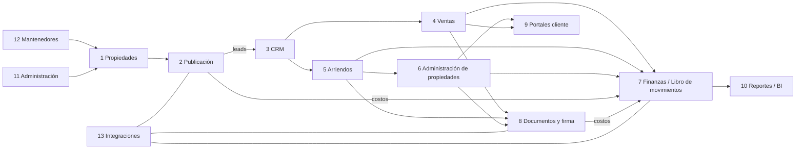
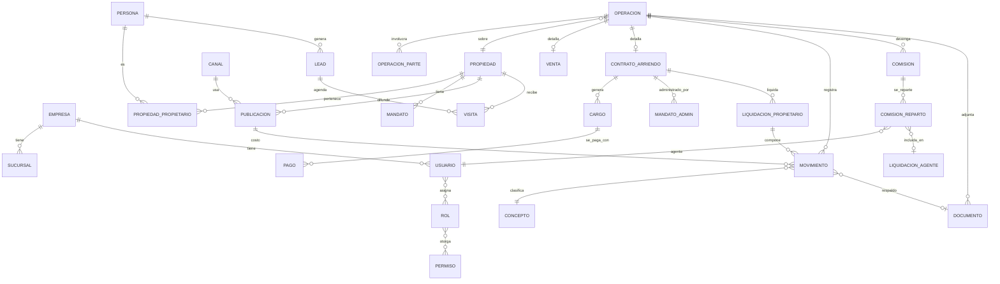

# Sistema de Corretaje Inmobiliario — Diseño de Arquitectura (Prompt Maestro)

Versión 0.1 · 2026-11-18 · Contexto: Chile (CLP/UF, SII, CBR, notarías)

---

## 1. Visión, alcance y actores

**Visión.** Plataforma SaaS multi-empresa para corredoras que unifica **venta, arriendo y administración** de propiedades, con **trazabilidad financiera de cada acción** (comisiones, costos de documentos, publicidad, mantenciones) para conocer la rentabilidad real de cada operación.

**Dentro del alcance:** captación, publicación multicanal, CRM, ventas, arriendos, administración de cartera, finanzas/comisiones, documentos y firma, portales de cliente, reportes, administración y mantenedores.
**Fuera del alcance (v1):** contabilidad tributaria completa (se exporta a software contable), tasaciones automáticas, marketplace propio.

| Actor | Responsabilidad principal |
|---|---|
| Super-admin (plataforma) | Alta de empresas, planes, soporte |
| Corredor/Gerente | Configuración, aprobaciones, reportes globales |
| Agente captador / vendedor | Propiedades, leads, visitas, operaciones |
| Administrador de propiedades | Cobros, liquidaciones, mantenciones |
| Contador / Finanzas | Libro de movimientos, comisiones, conciliación |
| Propietario | Seguimiento, liquidaciones, aprobaciones (portal) |
| Arrendatario | Estado de cuenta, pagos, solicitudes (portal) |
| Comprador | Favoritos, visitas, estado de su operación (portal) |

## 2. Mapa de módulos y dependencias



**Regla de dependencia:** todos los módulos operativos emiten *eventos de dominio* (`operacion.creada`, `reserva.confirmada`, `pago.recibido`, `documento.firmado`…). Finanzas los consume y genera/propone movimientos; nunca al revés.

## 3. Modelo de datos

### 3.1 Principios
- **Multi-tenant**: toda tabla de negocio lleva `empresa_id`; aislamiento con *Row Level Security* de PostgreSQL. `sucursal_id` donde aplique.
- **Dinero**: `NUMERIC(18,4)`; nunca `float`. Cada monto con `moneda` (CLP/UF/USD) y, si no es CLP, `valor_uf_o_tc` y `monto_clp` congelados a la fecha del hecho.
- **Auditoría**: `created_at/by`, `updated_at/by`, `deleted_at` (borrado lógico) + tabla `audit_log` inmutable.
- **Estados** como tablas de mantenedor con transiciones permitidas.
- **Libro de movimientos append-only**: no se edita, se corrige con contra-asiento.

### 3.2 ERD (núcleo)



### 3.3 Entidades principales

| Entidad | Atributos clave | Estados |
|---|---|---|
| `persona` | tipo (natural/jurídica), RUT, nombres, contactos, consentimiento datos, roles (propietario/comprador/arrendatario/aval/proveedor) | activa/inactiva |
| `propiedad` | tipo, dirección, comuna, rol SII, superficies, atributos, gastos comunes, contribuciones | borrador, captada, publicada, reservada, vendida, arrendada, retirada |
| `mandato` | tipo (venta/arriendo/administración), exclusividad, vigencia, comisión pactada, honorario admin | vigente, vencido, revocado |
| `publicacion` | propiedad, canal, id externo, precio publicado, texto, costo | pendiente, publicada, error, pausada, expirada |
| `lead` | fuente, campaña/UTM, persona, interés, agente | nuevo, contactado, visita, oferta, ganado, perdido(+motivo) |
| `operacion` | tipo (venta/arriendo/administración), propiedad, agente captador/vendedor, hito | por tipo (ver §3.4) |
| `contrato_arriendo` | canon, moneda, reajuste (IPC/UF/fijo, periodicidad), garantía, día de pago, vigencia | vigente, renovado, terminado |
| `cargo` / `pago` | concepto, periodo, monto, vencimiento / medio, fecha, conciliado | pendiente, pagado, vencido |
| `movimiento` | ver §4 | provisionado, facturado, pagado, anulado |
| `comision` / `comision_reparto` | regla aplicada, base, %, monto, IVA, hito de devengo | devengada, aprobada, pagada |
| `documento` | tipo, entidad asociada, versión, hash, firma, costo | vigente, vencido, firmado |

### 3.4 Estados de operación
- **Venta:** oferta → reserva → promesa → (crédito/tasación/estudio títulos) → escritura → inscripción CBR → entrega → cerrada | caída.
- **Arriendo:** postulación → aprobada → contrato firmado → entrega → vigente → renovación/término → restitución → cerrada.
- **Administración:** mandato activo → cobro mensual → liquidación → término de mandato.

### 3.5 DDL PostgreSQL (núcleo financiero y base)

```sql
CREATE EXTENSION IF NOT EXISTS pgcrypto;
CREATE TYPE moneda AS ENUM ('CLP','UF','USD');

CREATE TABLE empresa (
  id uuid PRIMARY KEY DEFAULT gen_random_uuid(),
  rut text UNIQUE NOT NULL, razon_social text NOT NULL,
  moneda_base moneda NOT NULL DEFAULT 'CLP',
  iva_pct numeric(5,2) NOT NULL DEFAULT 19.00,
  activa boolean NOT NULL DEFAULT true, created_at timestamptz DEFAULT now()
);

CREATE TABLE sucursal (
  id uuid PRIMARY KEY DEFAULT gen_random_uuid(),
  empresa_id uuid NOT NULL REFERENCES empresa, nombre text NOT NULL, activa boolean DEFAULT true
);

CREATE TABLE usuario (
  id uuid PRIMARY KEY DEFAULT gen_random_uuid(),
  empresa_id uuid NOT NULL REFERENCES empresa, sucursal_id uuid REFERENCES sucursal,
  email citext UNIQUE NOT NULL, nombre text NOT NULL, rut text,
  password_hash text, totp_secret text, activo boolean DEFAULT true
);

CREATE TABLE rol (id uuid PRIMARY KEY DEFAULT gen_random_uuid(), empresa_id uuid REFERENCES empresa, nombre text NOT NULL);
CREATE TABLE permiso (id serial PRIMARY KEY, modulo text NOT NULL, accion text NOT NULL, UNIQUE(modulo,accion));
CREATE TABLE rol_permiso (rol_id uuid REFERENCES rol, permiso_id int REFERENCES permiso, PRIMARY KEY(rol_id,permiso_id));
CREATE TABLE usuario_rol (usuario_id uuid REFERENCES usuario, rol_id uuid REFERENCES rol, PRIMARY KEY(usuario_id,rol_id));

CREATE TABLE persona (
  id uuid PRIMARY KEY DEFAULT gen_random_uuid(),
  empresa_id uuid NOT NULL REFERENCES empresa,
  tipo text CHECK (tipo IN ('natural','juridica')), rut text, nombre text NOT NULL,
  email text, telefono text, consentimiento_datos_at timestamptz,
  UNIQUE(empresa_id, rut)
);

CREATE TABLE propiedad (
  id uuid PRIMARY KEY DEFAULT gen_random_uuid(),
  empresa_id uuid NOT NULL REFERENCES empresa, sucursal_id uuid REFERENCES sucursal,
  codigo text NOT NULL, tipo_id int NOT NULL, comuna_id int NOT NULL,
  direccion text NOT NULL, rol_sii text,
  sup_util numeric(10,2), sup_terreno numeric(10,2),
  dormitorios smallint, banos smallint, atributos jsonb DEFAULT '{}',
  gasto_comun numeric(18,4), contribuciones numeric(18,4),
  estado_id int NOT NULL, agente_captador_id uuid REFERENCES usuario,
  UNIQUE(empresa_id,codigo)
);

CREATE TABLE operacion (
  id uuid PRIMARY KEY DEFAULT gen_random_uuid(),
  empresa_id uuid NOT NULL REFERENCES empresa,
  tipo text NOT NULL CHECK (tipo IN ('venta','arriendo','administracion','captacion')),
  propiedad_id uuid NOT NULL REFERENCES propiedad,
  agente_captador_id uuid REFERENCES usuario, agente_vendedor_id uuid REFERENCES usuario,
  estado_id int NOT NULL, precio numeric(18,4), moneda moneda DEFAULT 'CLP',
  abierta_at timestamptz DEFAULT now(), cerrada_at timestamptz
);

CREATE TABLE concepto (          -- mantenedor de conceptos de ingreso/egreso
  id serial PRIMARY KEY, empresa_id uuid REFERENCES empresa,
  codigo text NOT NULL, nombre text NOT NULL,
  naturaleza text NOT NULL CHECK (naturaleza IN ('ingreso','egreso')),
  afecto_iva boolean DEFAULT true, activo boolean DEFAULT true
);

-- LIBRO DE MOVIMIENTOS (append-only)
CREATE TABLE movimiento (
  id uuid PRIMARY KEY DEFAULT gen_random_uuid(),
  empresa_id uuid NOT NULL REFERENCES empresa,
  fecha date NOT NULL,
  operacion_id uuid REFERENCES operacion,
  propiedad_id uuid REFERENCES propiedad,
  publicacion_id uuid, contrato_id uuid, liquidacion_id uuid,
  concepto_id int NOT NULL REFERENCES concepto,
  tipo text NOT NULL CHECK (tipo IN ('ingreso','egreso','traspaso')),
  monto_neto numeric(18,4) NOT NULL CHECK (monto_neto >= 0),
  iva numeric(18,4) NOT NULL DEFAULT 0,
  monto_total numeric(18,4) GENERATED ALWAYS AS (monto_neto + iva) STORED,
  moneda moneda NOT NULL DEFAULT 'CLP',
  tipo_cambio numeric(18,6),            -- valor UF/USD a la fecha
  monto_clp numeric(18,4) NOT NULL,
  pagador text CHECK (pagador IN ('propietario','cliente','corredora','tercero')),
  contraparte_persona_id uuid REFERENCES persona,
  centro_costo_id int, documento_id uuid,
  estado text NOT NULL DEFAULT 'provisionado'
    CHECK (estado IN ('provisionado','facturado','pagado','anulado')),
  fondo text NOT NULL DEFAULT 'propio' CHECK (fondo IN ('propio','terceros')),
  reversa_de uuid REFERENCES movimiento,
  glosa text, created_by uuid NOT NULL, created_at timestamptz DEFAULT now()
);
CREATE INDEX ON movimiento (empresa_id, operacion_id);
CREATE INDEX ON movimiento (empresa_id, fecha);

CREATE TABLE regla_comision (
  id serial PRIMARY KEY, empresa_id uuid NOT NULL REFERENCES empresa,
  tipo_operacion text NOT NULL, base text NOT NULL CHECK (base IN ('precio','canon','renta_meses','fijo')),
  pct numeric(7,4), monto_fijo numeric(18,4), minimo numeric(18,4), tope numeric(18,4),
  parte_vendedor_pct numeric(5,2), parte_comprador_pct numeric(5,2),
  hito_devengo text NOT NULL, escala jsonb, vigente_desde date NOT NULL, vigente_hasta date
);

CREATE TABLE comision (
  id uuid PRIMARY KEY DEFAULT gen_random_uuid(),
  empresa_id uuid NOT NULL REFERENCES empresa, operacion_id uuid NOT NULL REFERENCES operacion,
  regla_id int REFERENCES regla_comision, base_monto numeric(18,4) NOT NULL,
  monto_neto numeric(18,4) NOT NULL, iva numeric(18,4) NOT NULL,
  estado text NOT NULL DEFAULT 'devengada' CHECK (estado IN ('devengada','aprobada','pagada','anulada'))
);

CREATE TABLE comision_reparto (
  id uuid PRIMARY KEY DEFAULT gen_random_uuid(),
  comision_id uuid NOT NULL REFERENCES comision,
  beneficiario_id uuid REFERENCES usuario,       -- NULL = corredora
  rol text NOT NULL CHECK (rol IN ('captador','vendedor','referido','corredora')),
  pct numeric(7,4) NOT NULL, monto numeric(18,4) NOT NULL, liquidacion_agente_id uuid
);

CREATE TABLE audit_log (
  id bigserial PRIMARY KEY, empresa_id uuid, usuario_id uuid, entidad text, entidad_id uuid,
  accion text, antes jsonb, despues jsonb, ip inet, at timestamptz DEFAULT now()
);

-- RLS multi-tenant (patrón; replicar por tabla)
ALTER TABLE movimiento ENABLE ROW LEVEL SECURITY;
CREATE POLICY tenant_iso ON movimiento
  USING (empresa_id = current_setting('app.empresa_id')::uuid);
-- Inmutabilidad del libro
CREATE RULE movimiento_no_update AS ON UPDATE TO movimiento
  WHERE OLD.estado = NEW.estado DO INSTEAD NOTHING;  -- solo se permite cambio de estado
```

> Faltan (se detallan en los prompts de módulo): `publicacion`, `canal`, `lead`, `visita`, `mandato`, `contrato_arriendo`, `cargo`, `pago`, `liquidacion_propietario`, `liquidacion_agente`, `documento`, tablas de mantenedores.

## 4. Principio rector: libro de movimientos

Toda acción de negocio puede generar movimientos con: fecha, operación/propiedad, concepto, monto neto, IVA, total, moneda + tipo de cambio, **quién paga**, estado, proveedor/cliente, documento de respaldo y centro de costo.

**Fuentes de movimientos**
| Origen | Movimiento | Disparo |
|---|---|---|
| Publicación en portal / pauta Meta | Egreso (publicidad) | Al publicar o ingreso manual |
| Documento (notaría, CBR, firma, certificados) | Egreso | Ingreso manual con respaldo |
| Comisión de venta/arriendo | Ingreso corredora + egresos a agentes | Hito de devengo |
| Cobro de arriendo | Ingreso (terceros) | Pago conciliado |
| Honorario de administración | Ingreso propio, egreso de fondos de terceros | Liquidación mensual |
| Mantención | Egreso (cargado al propietario) | Orden de trabajo cerrada |

**Reglas:** (1) los movimientos no se editan; se anulan con contra-movimiento. (2) Fondos de terceros nunca se mezclan con propios (`fondo`). (3) Monto sobre umbral → requiere aprobación. (4) Un movimiento sin respaldo queda marcado "sin documento".

### Ejemplo numérico (venta)
Venta UF 5.000 (UF = $39.000 → $195.000.000). Comisión 2% + IVA, pagada por vendedor.
- Comisión neta: $3.900.000; IVA 19%: $741.000; total: $4.641.000.
- Reparto: captador 30% ($1.170.000), vendedor 40% ($1.560.000), corredora 30% ($1.170.000).
- Costos: estudio de títulos $180.000 (paga vendedor), publicidad $120.000 (corredora), firma $25.000 (corredora).
- **Utilidad corredora** = 1.170.000 − 120.000 − 25.000 = **$1.025.000**.

*(Valores ilustrativos; la tasa y base de comisión las define cada empresa.)*

## 5. Roles y permisos (RBAC)

Permiso = `modulo.accion` (ver, crear, editar, eliminar, aprobar, exportar).

| Módulo | Gerente | Agente | Adm. propiedades | Finanzas | Propietario | Arrendatario |
|---|---|---|---|---|---|---|
| Propiedades | CRUD | CRU propias | R | R | R propias | — |
| Publicación | CRUD+aprobar | CRU | R | R costos | — | — |
| CRM | CRUD | CRUD propios | R | — | — | — |
| Ventas / Arriendos | CRUD+aprobar | CRU propias | CRU arriendos | R | R propias | — |
| Administración propiedades | CRUD | R | CRUD | R | R propias | R propio |
| Finanzas / Comisiones | CRUD+aprobar | R propias | R | CRUD+aprobar | R liquidaciones | R estado cuenta |
| Documentos | CRUD | CRU | CRU | R | R propios | R propios |
| Reportes | Todos | Propios | Cartera | Financieros | — | — |
| Administración / Mantenedores | CRUD | — | — | parcial | — | — |

**Aprobaciones por monto:** tabla `umbral_aprobacion(concepto, monto, rol_aprobador)`. Ej.: gasto > $500.000 requiere Gerente; mantención > $200.000 requiere aprobación del propietario.
**Alcance de datos:** por empresa → sucursal → equipo → propio (aplicado en consultas y RLS).

## 6. Arquitectura técnica recomendada

```mermaid
flowchart TB
  subgraph Cliente
    WEB[Web app SPA] 
    PORT[Portales propietario/arrendatario]
    MOV[App móvil agentes (PWA)]
  end
  GW[API Gateway / BFF] 
  WEB --> GW
  PORT --> GW
  MOV --> GW
  subgraph Backend[Monolito modular]
    CORE[Módulos de dominio]
    EVT[Bus de eventos interno]
    WRK[Workers / jobs]
  end
  GW --> CORE
  CORE --> EVT --> WRK
  CORE --> PG[(PostgreSQL + RLS)]
  WRK --> Q[(Cola: Redis/BullMQ o SQS)]
  CORE --> S3[(Almacenamiento objetos)]
  WRK --> ADP[Adaptadores integración]
  ADP --> EXT[Portales · Meta · WhatsApp · SII · Bancos · Firma · UF/IPC]
  CORE --> SRCH[(Búsqueda OpenSearch - fase 2)]
  PG --> DW[(Vistas/DW reportes)]
```

| Capa | Recomendación | Motivo |
|---|---|---|
| Arquitectura | **Monolito modular** (un módulo por dominio) con fronteras claras | Equipo pequeño; se separa luego si hace falta |
| Backend | TypeScript (NestJS) o Python (Django/FastAPI) | Ecosistema y productividad |
| Frontend | React/Next.js + librería de tablas/formularios | Backoffice denso + SEO sitio público |
| BD | PostgreSQL 16 con RLS | Multi-tenant seguro, JSONB, integridad |
| Jobs | Cola + scheduler | Cobros mensuales, reajustes, sincronización de portales, recordatorios |
| Archivos | Object storage cifrado + URLs firmadas | Documentos sensibles |
| Integraciones | Patrón adaptador + reintentos + dead-letter | Cada portal/API cambia por separado |
| Infra | Contenedores, CI/CD, IaC, entornos dev/stage/prod | Reproducibilidad |

**Seguridad y cumplimiento**
- Datos personales: Ley 19.628 y Ley 21.719 (nueva ley, vigencia diferida): consentimiento, finalidad, derechos ARCO+, registro de tratamientos, retención. *Validar plazos vigentes con asesor legal.*
- Cifrado en tránsito (TLS) y en reposo; secretos en gestor de secretos; credenciales de portales cifradas por empresa.
- 2FA para roles financieros; sesiones con expiración; límites de intentos; auditoría inmutable.
- Respaldos diarios con restauración probada; RPO ≤ 24 h, RTO ≤ 4 h (objetivo inicial).
- Observabilidad: logs estructurados, métricas, trazas, alertas en jobs críticos (cobros, liquidaciones).

## 7. Roadmap

| Fase | Contenido | Criterios de aceptación |
|---|---|---|
| **MVP (≈3 meses)** | Mantenedores, administración/RBAC, propiedades, CRM básico, **libro de movimientos**, ventas y arriendos (flujo + comisiones), documentos con plantillas, reportes base | Una corredora registra una venta y un arriendo completos con montos; la utilidad por operación cuadra con el cálculo manual; comisiones liquidadas por agente |
| **v1 (≈+3 meses)** | Administración de propiedades (cobros, reajustes, morosidad, liquidación al propietario, mantenciones), publicación en 1–2 portales + web propia, portales de propietario/arrendatario, conciliación bancaria, firma electrónica | Ciclo mensual completo de una cartera de prueba sin planillas; liquidación al propietario sin diferencias |
| **v2** | Meta/Instagram/WhatsApp, matching inteligente, IA para textos, facturación SII integrada, BI avanzado, app móvil, marketplace de proveedores | Costo por lead y rentabilidad por canal visibles; facturación emitida desde el sistema |

## 8. Riesgos y supuestos a validar

| # | Riesgo / supuesto | Mitigación |
|---|---|---|
| 1 | **Portal Inmobiliario** sin API pública verificada | Contactar área comercial; adaptador desacoplado; plan B de publicación asistida/feed |
| 2 | Tratamiento tributario (IVA en comisiones, boletas de honorarios, facturación electrónica) | Validar con contador; integrar vía proveedor certificado SII |
| 3 | Manejo de fondos de terceros (arriendos) | Separación contable `fondo=terceros`, cuentas bancarias distintas, revisión legal |
| 4 | Complejidad de reajustes (IPC/UF) y valores históricos | Mantenedor de índices con fuente oficial y carga manual de respaldo |
| 5 | Cambios de términos de uso de Meta/WhatsApp | Aislar en adaptador; revisar políticas antes de construir |
| 6 | Adopción por agentes (resistencia a ingresar montos) | UX mínima, plantillas de costos, importación Excel, móvil |
| 7 | Alcance excesivo | Priorizar MVP en libro de movimientos + ventas/arriendos |
| 8 | Ley 21.719 de datos personales | Privacy by design desde el MVP; asesoría legal |

### Supuestos
- Mercado inicial: Chile; moneda base CLP con soporte UF.
- Una corredora por empresa-tenant, varias sucursales.
- Contabilidad formal se exporta; el sistema no reemplaza al contador.
- Equipo inicial de 3–5 personas de desarrollo.

## 9. Próximos pasos
1. Aprobar este diseño y decisiones abiertas (stack, firma electrónica, proveedor de facturación).
2. Ejecutar prompt **4.12 Mantenedores** y **4.11 Administración**.
3. Ejecutar **4.1 Propiedades** y **4.7 Finanzas** (detallan DDL faltante).
