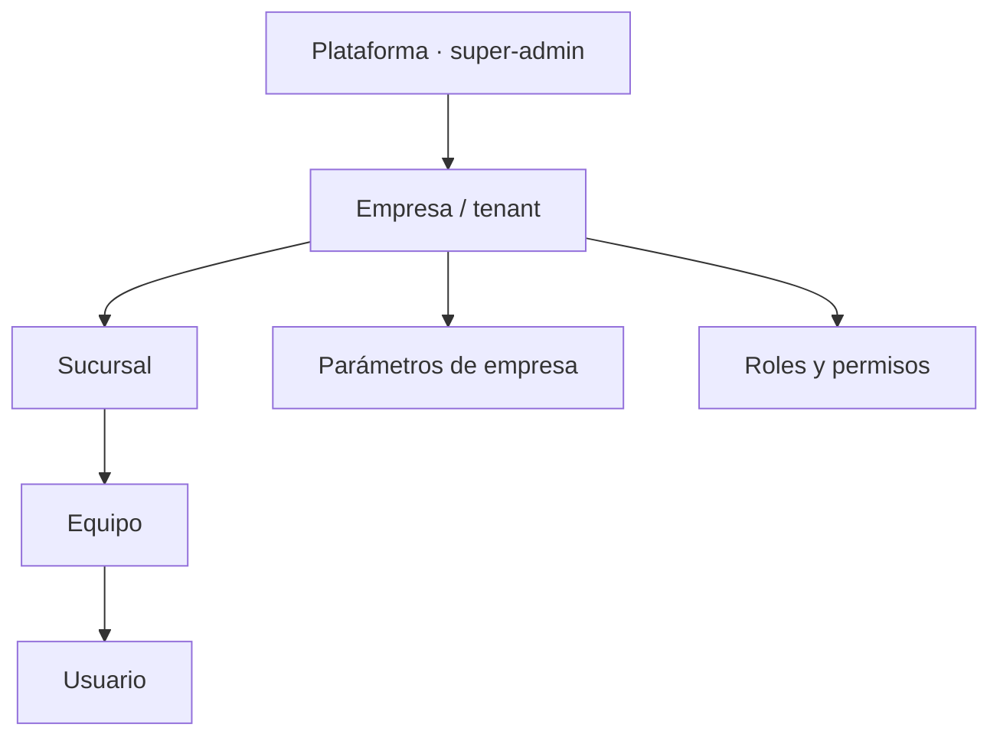

# Módulos 12 (Mantenedores) y 11 (Administración) — Diseño detallado

Continúa de `01_arquitectura_maestro.md`. Contexto: Chile, PostgreSQL multi-tenant.

---

# PARTE A — MANTENEDORES

## A1. Objetivo y alcance
Capa de catálogos parametrizables que alimenta a todos los módulos. Cada empresa puede ajustar los catálogos sin tocar código. Hay dos niveles:
- **Sistema (global):** definidos por la plataforma, de solo lectura para empresas (regiones/comunas, monedas, tipos de documento tributario).
- **Empresa:** editables por la corredora (conceptos, fuentes de lead, checklists, proveedores…). Pueden *extender* o *desactivar* valores globales, nunca borrarlos.

## A2. Catálogo de mantenedores

| Grupo | Mantenedor | Nivel | Notas |
|---|---|---|---|
| Geografía | Región, Provincia, Comuna | Sistema | Carga inicial oficial (CUT) |
| Propiedad | Tipo de propiedad, Subtipo, Amenities, Orientaciones, Estado legal | Empresa | Amenities con icono y categoría |
| Operación | Tipo de operación, Estados de propiedad/operación/lead/contrato/publicación | Empresa + transiciones | Ver A5 |
| CRM | Fuentes de lead, Motivos de pérdida, Etiquetas, Tipos de interacción | Empresa | |
| Finanzas | Monedas, Conceptos de ingreso/egreso, Centros de costo, Medios de pago, Bancos y tipos de cuenta, Impuestos | Mixto | Conceptos con IVA por defecto |
| Índices | UF, UTM, IPC, USD | Sistema | Carga automática + manual (A6) |
| Comisiones | Tipos de comisión, Reglas y escalas, Roles de reparto | Empresa | Vigencia por fechas |
| Documentos | Tipos de documento (con vencimiento y obligatoriedad), Plantillas, Checklists por etapa | Empresa | |
| Terceros | Proveedores, Categorías de proveedor, Notarías, Conservadores | Empresa | |
| Publicación | Canales y planes de costo | Empresa | Costo referencial por plan |
| Seguridad | Roles (ver Parte B) | Empresa | |
| Cobranza | Plantillas de recordatorio, Tasas de interés/multa | Empresa | |

## A3. Esquema genérico reutilizable

Para catálogos simples se usa **una tabla por mantenedor** con columnas estándar (más fácil de integrar que EAV) y un *registro de metadatos* que alimenta una pantalla CRUD genérica.

```sql
-- Columnas estándar de TODO mantenedor (se repite por tabla)
--   id serial PK, empresa_id uuid NULL (NULL = global), codigo text, nombre text,
--   descripcion text, orden int, activo boolean, vigente_desde date, vigente_hasta date,
--   es_sistema boolean (no editable/borrable), created_at/by, updated_at/by

CREATE TABLE tipo_propiedad (
  id serial PRIMARY KEY,
  empresa_id uuid REFERENCES empresa,            -- NULL = catálogo de sistema
  codigo text NOT NULL, nombre text NOT NULL, descripcion text,
  orden int NOT NULL DEFAULT 0, activo boolean NOT NULL DEFAULT true,
  vigente_desde date, vigente_hasta date,
  es_sistema boolean NOT NULL DEFAULT false,
  created_at timestamptz DEFAULT now(), created_by uuid,
  updated_at timestamptz, updated_by uuid,
  UNIQUE NULLS NOT DISTINCT (empresa_id, codigo)
);

-- Metadatos para CRUD genérico y reglas de integridad
CREATE TABLE mantenedor_def (
  id serial PRIMARY KEY, clave text UNIQUE NOT NULL, tabla text NOT NULL,
  nombre text NOT NULL, grupo text, nivel text CHECK (nivel IN ('sistema','empresa','mixto')),
  campos jsonb NOT NULL,           -- definición de campos extra y validaciones
  permiso_ver text, permiso_editar text
);

CREATE TABLE mantenedor_uso (       -- dónde se referencia cada mantenedor (para bloquear borrado)
  mantenedor_clave text REFERENCES mantenedor_def(clave),
  tabla_ref text NOT NULL, columna_ref text NOT NULL,
  PRIMARY KEY (mantenedor_clave, tabla_ref, columna_ref)
);
```

### Mantenedores con estructura propia

```sql
-- Estados y transiciones permitidas
CREATE TABLE estado (
  id serial PRIMARY KEY, empresa_id uuid REFERENCES empresa,
  entidad text NOT NULL CHECK (entidad IN ('propiedad','operacion_venta','operacion_arriendo',
       'lead','contrato','publicacion','mandato','movimiento')),
  codigo text NOT NULL, nombre text NOT NULL, color text, orden int,
  es_inicial boolean DEFAULT false, es_final boolean DEFAULT false, activo boolean DEFAULT true,
  UNIQUE NULLS NOT DISTINCT (empresa_id, entidad, codigo)
);
CREATE TABLE estado_transicion (
  desde_id int REFERENCES estado, hacia_id int REFERENCES estado,
  requiere_permiso text, requiere_motivo boolean DEFAULT false, evento text,
  PRIMARY KEY (desde_id, hacia_id)
);

-- Conceptos financieros
CREATE TABLE concepto (   -- amplía la del maestro
  id serial PRIMARY KEY, empresa_id uuid REFERENCES empresa,
  codigo text NOT NULL, nombre text NOT NULL,
  naturaleza text NOT NULL CHECK (naturaleza IN ('ingreso','egreso')),
  categoria text,                      -- 'comision','documento','publicidad','mantencion','honorario'...
  afecto_iva boolean DEFAULT true, iva_pct_defecto numeric(5,2),
  pagador_defecto text, requiere_respaldo boolean DEFAULT false,
  centro_costo_id int, cuenta_contable text,   -- para exportación contable
  monto_referencial numeric(18,4), moneda_ref moneda,
  activo boolean DEFAULT true, es_sistema boolean DEFAULT false,
  UNIQUE NULLS NOT DISTINCT (empresa_id, codigo)
);

-- Índices económicos
CREATE TABLE indice_economico (
  id serial PRIMARY KEY, codigo text UNIQUE NOT NULL,     -- UF, UTM, IPC, USD
  nombre text NOT NULL, periodicidad text CHECK (periodicidad IN ('diaria','mensual')),
  fuente_url text, carga_automatica boolean DEFAULT true
);
CREATE TABLE indice_valor (
  indice_id int REFERENCES indice_economico, fecha date NOT NULL,
  valor numeric(18,6) NOT NULL, origen text CHECK (origen IN ('api','manual')),
  cargado_por uuid, cargado_at timestamptz DEFAULT now(),
  PRIMARY KEY (indice_id, fecha)
);

-- Checklists por etapa
CREATE TABLE checklist_plantilla (
  id serial PRIMARY KEY, empresa_id uuid NOT NULL REFERENCES empresa,
  tipo_operacion text NOT NULL, estado_id int NOT NULL REFERENCES estado, nombre text NOT NULL, activo boolean DEFAULT true
);
CREATE TABLE checklist_item (
  id serial PRIMARY KEY, plantilla_id int REFERENCES checklist_plantilla,
  descripcion text NOT NULL, obligatorio boolean DEFAULT true,
  tipo_documento_id int, rol_responsable text, plazo_dias int, orden int,
  concepto_costo_id int REFERENCES concepto      -- si genera costo esperado
);

-- Tipos de documento
CREATE TABLE tipo_documento (
  id serial PRIMARY KEY, empresa_id uuid REFERENCES empresa, codigo text NOT NULL, nombre text NOT NULL,
  entidad_aplica text[],                -- propiedad, persona, operacion, contrato
  vence boolean DEFAULT false, dias_alerta int, obligatorio_en text[],
  requiere_firma boolean DEFAULT false, concepto_costo_id int REFERENCES concepto,
  activo boolean DEFAULT true
);

-- Canales de publicación y planes
CREATE TABLE canal (
  id serial PRIMARY KEY, empresa_id uuid REFERENCES empresa, codigo text NOT NULL, nombre text NOT NULL,
  tipo text CHECK (tipo IN ('portal','rrss','web','mensajeria','email')),
  adaptador text, activo boolean DEFAULT true
);
CREATE TABLE canal_plan (
  id serial PRIMARY KEY, canal_id int REFERENCES canal, nombre text NOT NULL,
  costo numeric(18,4), moneda moneda DEFAULT 'CLP', duracion_dias int, destacado boolean DEFAULT false,
  concepto_costo_id int REFERENCES concepto
);

-- Reglas de comisión: ver regla_comision del maestro (con vigencia y escalas jsonb)

-- Proveedores
CREATE TABLE categoria_proveedor (id serial PRIMARY KEY, empresa_id uuid REFERENCES empresa, nombre text NOT NULL, activo boolean DEFAULT true);
CREATE TABLE proveedor (
  id uuid PRIMARY KEY DEFAULT gen_random_uuid(), empresa_id uuid NOT NULL REFERENCES empresa,
  persona_id uuid NOT NULL REFERENCES persona, categoria_id int REFERENCES categoria_proveedor,
  banco_id int, tipo_cuenta text, numero_cuenta text, email_pagos text, calificacion smallint, activo boolean DEFAULT true
);

-- Bancos / medios de pago / centros de costo / impuestos (esquema estándar del A3)
CREATE TABLE centro_costo (id serial PRIMARY KEY, empresa_id uuid NOT NULL REFERENCES empresa, codigo text, nombre text,
  padre_id int REFERENCES centro_costo, sucursal_id uuid REFERENCES sucursal, activo boolean DEFAULT true);
```

## A4. Reglas de integridad

1. **No borrar si hay uso:** `DELETE` solo permitido si ninguna fila referencia el registro (según `mantenedor_uso`). En su lugar se **desactiva** (`activo=false`): deja de aparecer en listas nuevas pero se muestra en registros históricos.
2. **Registros `es_sistema=true`:** no editables ni desactivables por la empresa (sí se pueden *ocultar* en su vista).
3. **Código inmutable** tras el primer uso (el nombre sí puede cambiar).
4. **Vigencia:** no se pueden seleccionar valores fuera de vigencia; los históricos conservan el valor con el que se usaron.
5. **Congelado de valores financieros:** al usar un concepto, el movimiento guarda su propio monto/IVA; cambiar el valor referencial no altera movimientos previos.
6. **Cambios de reglas de comisión:** crean una **nueva versión** con `vigente_desde`; nunca se modifica una regla ya aplicada.
7. **Transiciones de estado:** solo las definidas en `estado_transicion`; al menos un estado inicial y uno final por entidad.
8. **Unicidad:** (`empresa_id`,`codigo`) con NULLS NOT DISTINCT (PostgreSQL 15+).
9. Toda alta/edición/desactivación escribe en `audit_log`.

## A5. Estados y transiciones — valores iniciales (semilla)

**Venta:** `oferta → reserva → promesa → en_financiamiento → escritura → inscripcion → entregada → cerrada` · salidas a `caida` desde cualquier estado previo a `escritura` (requiere motivo).
**Arriendo:** `postulacion → aprobada → contrato_firmado → entregada → vigente → termino → restituida → cerrada` · `rechazada` desde postulación.
**Lead:** `nuevo → contactado → visita → oferta → ganado` · `perdido` (con motivo).
**Propiedad:** `borrador → captada → publicada → reservada → vendida/arrendada` · `retirada`.
**Publicación:** `pendiente → publicada → pausada/expirada` · `error`.

## A6. Índices económicos (UF, UTM, IPC, USD)

- **Carga automática:** job diario (UF/USD) y mensual (IPC/UTM) contra fuente oficial (Banco Central/CMF o servicio como mindicador.cl). Se debe confirmar la fuente a usar y sus condiciones.
- **Carga manual:** pantalla con respaldo (adjunto) para corregir o cuando falla la fuente; `origen='manual'` y auditoría.
- **UF a futuro:** la UF se conoce con anticipación (variación del 10 al 9 del mes siguiente); el job precarga el período completo.
- **Falla de fuente:** alerta a administrador; el sistema usa el último valor válido solo si el usuario lo confirma, nunca silenciosamente.
- **Consulta:** función `valor_indice(codigo, fecha)` usada por reajustes, movimientos y cargos.

## A7. Pantallas

1. **Lista de mantenedores** agrupada (buscador, filtros por grupo).
2. **CRUD genérico:** grilla con búsqueda, orden por arrastre, filtro activo/inactivo, edición en panel lateral, validación inline, historial de cambios por registro.
3. **Editor de estados:** diagrama de transiciones (arrastrar flechas), vista previa del tablero kanban.
4. **Editor de reglas de comisión:** formulario con simulador ("ingresa precio → ve reparto").
5. **Editor de checklists:** lista ordenable con documentos requeridos y costos esperados.
6. **Índices:** serie temporal, carga manual, estado de última sincronización.
7. **Importación/exportación Excel** para catálogos grandes (proveedores, comunas custom).

## A8. API REST (genérica)

```
GET    /api/mantenedores                    → lista de definiciones
GET    /api/m/{clave}?activo=&q=&page=      → listado paginado
POST   /api/m/{clave}                       → crear
PATCH  /api/m/{clave}/{id}                  → editar
POST   /api/m/{clave}/{id}/desactivar       → desactivar (reactivar con /activar)
DELETE /api/m/{clave}/{id}                  → solo si sin uso (409 si en uso)
GET    /api/m/{clave}/{id}/historial        → auditoría
POST   /api/m/{clave}/importar              → Excel
GET    /api/indices/{codigo}?fecha=         → valor
PUT    /api/indices/{codigo}/{fecha}        → carga manual (permiso + respaldo)
GET    /api/estados/{entidad}/transiciones  → grafo
```
Errores estándar: `422` validación, `409` conflicto de uso o duplicado, `403` permiso.

## A9. Datos semilla (resumen)
- Regiones/comunas (oficial), tipos de propiedad (casa, departamento, oficina, local, terreno, bodega, estacionamiento, parcela), monedas (CLP, UF, USD), IVA 19 %.
- Conceptos base: *Comisión de venta*, *Comisión de arriendo*, *Honorario de administración*, *Estudio de títulos*, *Notaría*, *CBR*, *Tasación*, *Firma electrónica*, *Informe comercial*, *Publicación en portal*, *Pauta Meta*, *Fotografía profesional*, *Mantención*, *Contribuciones*, *Gastos comunes*.
- Fuentes de lead: Portal Inmobiliario, Yapo, Instagram, Facebook, WhatsApp, Web propia, Referido, Letrero, Llamada.
- Motivos de pérdida: precio, compró otra, financiamiento rechazado, desistió, sin respuesta.
- Estados de §A5 con sus transiciones.

---

# PARTE B — ADMINISTRACIÓN DEL SISTEMA

## B1. Objetivo
Configuración y gobierno de la plataforma: empresas, sucursales, usuarios, permisos, parámetros, seguridad, auditoría e importaciones.

## B2. Estructura multi-tenant



```sql
CREATE TABLE equipo (id serial PRIMARY KEY, empresa_id uuid NOT NULL REFERENCES empresa, sucursal_id uuid REFERENCES sucursal,
  nombre text NOT NULL, lider_id uuid REFERENCES usuario);
CREATE TABLE usuario_equipo (usuario_id uuid REFERENCES usuario, equipo_id int REFERENCES equipo, PRIMARY KEY(usuario_id,equipo_id));

CREATE TABLE parametro (
  id serial PRIMARY KEY, empresa_id uuid REFERENCES empresa, clave text NOT NULL,
  valor jsonb NOT NULL, tipo text, descripcion text, updated_by uuid, updated_at timestamptz,
  UNIQUE NULLS NOT DISTINCT (empresa_id, clave)
);
-- Ejemplos de claves: moneda_base, iva_pct, zona_horaria, formato_codigo_propiedad,
-- dias_alerta_mandato, hora_cobro_mensual, interes_mora_pct, aprobacion_gasto_umbral

CREATE TABLE umbral_aprobacion (
  id serial PRIMARY KEY, empresa_id uuid NOT NULL REFERENCES empresa,
  concepto_id int REFERENCES concepto, categoria text, monto_desde_clp numeric(18,4) NOT NULL,
  rol_aprobador_id uuid NOT NULL REFERENCES rol, requiere_propietario boolean DEFAULT false
);
CREATE TABLE aprobacion (
  id uuid PRIMARY KEY DEFAULT gen_random_uuid(), empresa_id uuid NOT NULL REFERENCES empresa,
  entidad text NOT NULL, entidad_id uuid NOT NULL, solicitado_por uuid NOT NULL, aprobador_id uuid,
  estado text CHECK (estado IN ('pendiente','aprobada','rechazada','expirada')) DEFAULT 'pendiente',
  comentario text, solicitado_at timestamptz DEFAULT now(), resuelto_at timestamptz
);
CREATE TABLE secuencia (empresa_id uuid, clave text, prefijo text, siguiente bigint DEFAULT 1, PRIMARY KEY (empresa_id, clave));
CREATE TABLE plantilla_notificacion (
  id serial PRIMARY KEY, empresa_id uuid REFERENCES empresa, evento text NOT NULL,
  canal text CHECK (canal IN ('email','whatsapp','sms','push','interna')),
  asunto text, cuerpo text NOT NULL, variables text[], activa boolean DEFAULT true
);
CREATE TABLE importacion (
  id uuid PRIMARY KEY DEFAULT gen_random_uuid(), empresa_id uuid, entidad text, archivo_ref text,
  estado text, filas_total int, filas_ok int, filas_error int, errores jsonb, creado_por uuid, creado_at timestamptz DEFAULT now()
);
CREATE TABLE sesion (id uuid PRIMARY KEY, usuario_id uuid REFERENCES usuario, ip inet, user_agent text, creada_at timestamptz, expira_at timestamptz, revocada boolean DEFAULT false);
```

## B3. Usuarios y roles

- **Alta:** invitación por email con enlace de un solo uso; el usuario define contraseña y activa 2FA.
- **Roles base (plantillas de sistema):** Gerente, Agente, Administrador de propiedades, Finanzas, Solo lectura. Cada empresa puede **clonar y modificar**; no puede editar la plantilla original.
- **Permisos** = `modulo.accion` (§5 del maestro). Pantalla matriz rol × módulo × acción.
- **Alcance de datos** (por usuario/rol): `empresa | sucursal | equipo | propios`. Se aplica en consultas y en RLS (`app.empresa_id`, `app.sucursal_id`, `app.usuario_id`).
- **Reglas:** el último Gerente activo no puede desactivarse; un usuario no puede aprobar sus propias solicitudes; separación de funciones (quien registra un pago de comisión no lo aprueba).
- **Baja:** desactivación (no borrado); reasignación guiada de propiedades, leads y tareas abiertas.
- Cuentas externas (propietario, arrendatario, comprador) son `persona` con acceso a portal, en tabla de credenciales separada con alcance restringido a sus propias entidades.

## B4. Seguridad
- Contraseñas con hash moderno (Argon2id), política de complejidad y expiración opcional.
- **2FA obligatorio** para roles con permisos financieros o de administración; opcional para el resto (TOTP).
- Bloqueo tras N intentos fallidos, recuperación con enlace temporal, alertas de inicio de sesión inusual.
- Sesiones con expiración por inactividad y revocación remota.
- Listas de IP permitidas por empresa (opcional).
- Credenciales de integraciones cifradas por empresa y nunca devueltas por API.
- Anonimización/eliminación de datos personales bajo solicitud, con registro (ver Ley de datos personales).

## B5. Auditoría
- `audit_log` con quién, qué, cuándo, IP, valor anterior y nuevo; consulta con filtros (usuario, entidad, rango, acción).
- Eventos críticos marcados: cambios de permisos, de reglas de comisión, anulación de movimientos, cambios de mandato, exportaciones masivas, inicios de sesión fallidos.
- Inmutable: sin UPDATE/DELETE para el rol de aplicación; retención configurable (≥ 5 años recomendado para datos financieros, validar con el contador).
- **Logs de integraciones:** cada llamada saliente/entrante (canal, endpoint, estado, duración, error) con reintentos y botón "reintentar".

## B6. Importación / exportación masiva
- Plantillas Excel descargables (propiedades, personas, propietarios, contratos, conceptos, proveedores, saldos iniciales).
- Flujo: subir → **validación en seco** con reporte de errores por fila → confirmar → carga en transacción → resumen; posibilidad de revertir un lote.
- Exportación a Excel/CSV con permiso `exportar` y registro de auditoría.
- Exportación contable (asientos por periodo según `cuenta_contable` del concepto) — formato a definir con el contador.

## B7. Pantallas
1. **Empresas** (solo super-admin): alta, plan, estado, límites.
2. **Sucursales y equipos.**
3. **Usuarios:** listado, invitación, roles, alcance, estado, últimos accesos.
4. **Roles y permisos:** matriz con plantillas.
5. **Parámetros generales** agrupados (moneda, IVA, zona horaria, numeración, cobros, mora).
6. **Aprobaciones:** umbrales y bandeja de pendientes.
7. **Plantillas de notificación** con variables y vista previa.
8. **Auditoría** y **logs de integración.**
9. **Importaciones:** historial de lotes.
10. **Seguridad:** 2FA, sesiones activas, IP permitidas.

## B8. API (resumen)
```
/api/auth/login, /logout, /2fa/verify, /password/reset
/api/usuarios (CRUD + invitar + desactivar + reasignar)
/api/roles (CRUD + clonar), /api/permisos
/api/sucursales, /api/equipos
/api/parametros/{clave}
/api/aprobaciones (bandeja, aprobar, rechazar)
/api/umbrales-aprobacion
/api/plantillas-notificacion
/api/auditoria?usuario=&entidad=&desde=&hasta=
/api/integraciones/logs, /api/integraciones/logs/{id}/reintentar
/api/importaciones (subir, validar, confirmar, revertir)
```

## B9. Criterios de aceptación (MVP)
- Crear empresa, sucursal y 3 usuarios con distintos roles; cada uno ve solo lo que su alcance permite (prueba de aislamiento entre empresas).
- Un gasto sobre el umbral queda pendiente hasta que lo aprueba un rol distinto al solicitante.
- Desactivar un concepto en uso no rompe movimientos históricos ni la lista de nuevos movimientos.
- Cambiar una regla de comisión crea versión nueva y no altera comisiones ya devengadas.
- Carga masiva de 500 propiedades con 10 errores reporta fila y motivo de cada uno y no carga parcialmente.
- La UF de hoy está disponible; si la fuente falla, se alerta y se permite carga manual con respaldo.
- Toda modificación de permisos aparece en auditoría con valor anterior y nuevo.

## B10. Riesgos y pendientes
- Fuente oficial y condiciones de uso de índices (UF/IPC/UTM): confirmar.
- Política de retención de datos y auditoría: validar con asesor legal/contable.
- Nivel de granularidad de permisos: riesgo de sobreingeniería; empezar con `modulo.accion` y alcance de 4 niveles.
- Definir si los proveedores tendrán acceso al sistema (no en MVP).

---

## Siguiente paso
Ejecutar **4.1 Propiedades y captación** y **4.7 Finanzas y costos por operación** (completan el DDL y las reglas de comisión).
