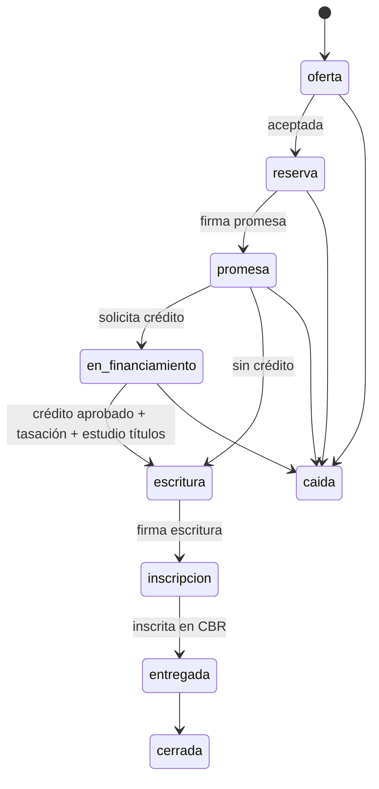
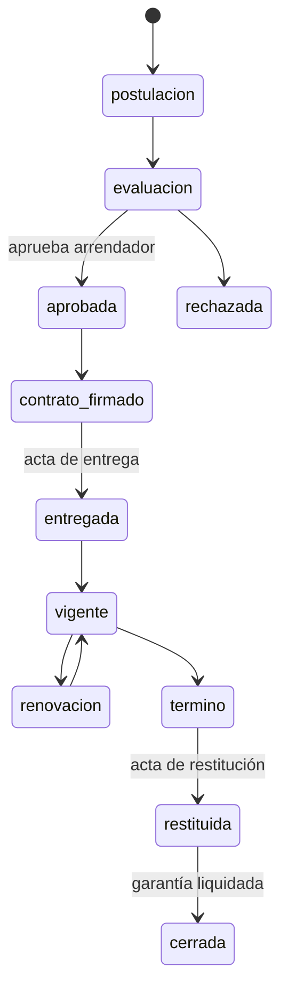

# Módulos 3 (CRM), 4 (Ventas) y 5 (Arriendos)

Continúa de documentos 01–03. PostgreSQL 15+, multi-tenant (`empresa_id` + RLS). Eventos de dominio alimentan Finanzas (doc 03, §B11).

---

# PARTE A — CRM Y LEADS

## A1. Casos de uso
| # | Caso | Actor |
|---|---|---|
| C1 | Capturar lead (formulario web, portal, WhatsApp, Meta Lead Ads, llamada, manual) | Sistema / Agente |
| C2 | Asignar lead (round-robin, por zona, por propiedad consultada) | Sistema / Gerente |
| C3 | Gestionar embudo (kanban) | Agente |
| C4 | Registrar interacciones (llamada, correo, WhatsApp, nota) | Agente |
| C5 | Agendar y confirmar visitas | Agente / Cliente |
| C6 | Registrar feedback de visita | Agente |
| C7 | Guardar búsqueda/demanda del cliente y hacer matching | Agente / Sistema |
| C8 | Secuencias de seguimiento automáticas | Sistema |
| C9 | Deduplicar y fusionar contactos | Agente / Gerente |
| C10 | Gestionar consentimiento y baja de comunicaciones | Sistema |

## A2. Modelo de datos
`persona` ya existe (doc 01). Se amplía y se agregan las tablas del CRM.

```sql
ALTER TABLE persona
  ADD COLUMN telefono_whatsapp text, ADD COLUMN nacionalidad text, ADD COLUMN profesion text,
  ADD COLUMN etiquetas text[] DEFAULT '{}', ADD COLUMN fuente_origen_id int,
  ADD COLUMN no_contactar boolean DEFAULT false, ADD COLUMN fusionada_en uuid REFERENCES persona,
  ADD COLUMN agente_responsable_id uuid REFERENCES usuario;

CREATE TABLE persona_rol (       -- una persona puede tener varios roles
  persona_id uuid REFERENCES persona, rol text CHECK (rol IN
   ('propietario','comprador','arrendatario','aval','inversionista','proveedor','referidor')),
  PRIMARY KEY (persona_id, rol)
);

CREATE TABLE lead (
  id uuid PRIMARY KEY DEFAULT gen_random_uuid(),
  empresa_id uuid NOT NULL REFERENCES empresa, persona_id uuid NOT NULL REFERENCES persona,
  fuente_id int NOT NULL, canal_id int, publicacion_id uuid, propiedad_id uuid REFERENCES propiedad,
  campana text, utm jsonb, interes text CHECK (interes IN ('comprar','arrendar','vender','arrendar_propiedad_propia','administrar')),
  mensaje text, estado_id int NOT NULL, motivo_perdida_id int, agente_id uuid REFERENCES usuario,
  asignado_at timestamptz, primer_contacto_at timestamptz,
  presupuesto_min numeric(18,4), presupuesto_max numeric(18,4), moneda moneda,
  probabilidad smallint CHECK (probabilidad BETWEEN 0 AND 100),
  created_at timestamptz DEFAULT now(), cerrado_at timestamptz
);
CREATE INDEX ON lead (empresa_id, estado_id, agente_id);

CREATE TABLE interaccion (
  id bigserial PRIMARY KEY, empresa_id uuid NOT NULL, persona_id uuid NOT NULL, lead_id uuid, operacion_id uuid,
  tipo text CHECK (tipo IN ('llamada','email','whatsapp','nota','reunion','visita','sistema')),
  direccion text CHECK (direccion IN ('entrante','saliente')), asunto text, detalle text,
  usuario_id uuid, at timestamptz DEFAULT now(), externo_id text
);

CREATE TABLE tarea (
  id uuid PRIMARY KEY DEFAULT gen_random_uuid(), empresa_id uuid NOT NULL, titulo text NOT NULL,
  vence_at timestamptz, asignada_a uuid REFERENCES usuario, lead_id uuid, operacion_id uuid, propiedad_id uuid,
  tipo text, estado text DEFAULT 'pendiente' CHECK (estado IN ('pendiente','hecha','cancelada')), completada_at timestamptz
);

CREATE TABLE visita (
  id uuid PRIMARY KEY DEFAULT gen_random_uuid(), empresa_id uuid NOT NULL,
  propiedad_id uuid NOT NULL REFERENCES propiedad, lead_id uuid REFERENCES lead, persona_id uuid REFERENCES persona,
  agente_id uuid NOT NULL REFERENCES usuario, inicio timestamptz NOT NULL, fin timestamptz NOT NULL,
  estado text DEFAULT 'agendada' CHECK (estado IN ('agendada','confirmada','realizada','no_asistio','cancelada','reprogramada')),
  recordatorio_enviado boolean DEFAULT false, calendario_evento_id text,
  interes_nivel smallint CHECK (interes_nivel BETWEEN 1 AND 5), feedback text, objeciones text[],
  CHECK (fin > inicio)
);
-- Evita doble reserva del agente
ALTER TABLE visita ADD CONSTRAINT visita_sin_solape
  EXCLUDE USING gist (agente_id WITH =, tstzrange(inicio, fin) WITH &&)
  WHERE (estado IN ('agendada','confirmada'));

CREATE TABLE demanda (           -- búsqueda guardada del cliente
  id uuid PRIMARY KEY DEFAULT gen_random_uuid(), empresa_id uuid NOT NULL, persona_id uuid NOT NULL REFERENCES persona,
  operacion text CHECK (operacion IN ('compra','arriendo')), tipos_propiedad int[], comunas int[],
  precio_min numeric(18,4), precio_max numeric(18,4), moneda moneda, dormitorios_min smallint, banos_min smallint,
  sup_min numeric(10,2), requiere_estacionamiento boolean, acepta_mascotas boolean, amenities int[],
  vigente_hasta date, activa boolean DEFAULT true
);
CREATE TABLE match_propiedad (
  demanda_id uuid REFERENCES demanda, propiedad_id uuid REFERENCES propiedad,
  puntaje smallint, calculado_at timestamptz DEFAULT now(), notificado boolean DEFAULT false, descartado boolean DEFAULT false,
  PRIMARY KEY (demanda_id, propiedad_id)
);

CREATE TABLE secuencia_seguimiento (
  id serial PRIMARY KEY, empresa_id uuid NOT NULL, nombre text, evento_inicio text, activa boolean DEFAULT true
);
CREATE TABLE secuencia_paso (
  id serial PRIMARY KEY, secuencia_id int REFERENCES secuencia_seguimiento, orden int, espera_horas int NOT NULL,
  canal text, plantilla_id int, condicion jsonb         -- ej. {"sin_respuesta":true}
);
CREATE TABLE secuencia_ejecucion (
  id bigserial PRIMARY KEY, secuencia_id int, lead_id uuid, paso_actual int, proxima_at timestamptz,
  estado text DEFAULT 'activa' CHECK (estado IN ('activa','pausada','completada','cancelada'))
);

CREATE TABLE consentimiento (
  persona_id uuid REFERENCES persona, finalidad text NOT NULL, canal text, otorgado boolean NOT NULL,
  at timestamptz DEFAULT now(), origen text, evidencia jsonb, PRIMARY KEY (persona_id, finalidad, canal, at)
);
```

## A3. Reglas de negocio
1. **Deduplicación:** al crear lead/persona, buscar por RUT, email y teléfono normalizado (E.164); si existe, **reutilizar la persona** y crear un lead nuevo; ofrecer fusión de duplicados (historial se conserva, `fusionada_en`).
2. **Asignación:** orden de prioridad configurable: (1) agente captador de la propiedad consultada, (2) agente responsable previo de la persona, (3) round-robin entre agentes activos y disponibles, (4) por zona. Sin respuesta del agente en N minutos → reasignación y alerta.
3. **SLA de respuesta:** primer contacto en ≤ X minutos (parámetro). Se mide `primer_contacto_at − asignado_at`.
4. **Estados** (mantenedor): `nuevo → contactado → visita → oferta → ganado`; `perdido` exige motivo. Pasar a `ganado` solicita crear/vincular una **operación**.
5. **Visitas:** no solapar agenda del agente; confirmar con el cliente por WhatsApp/email 24 h antes; `no_asistio` incrementa contador y puede disparar secuencia de reagendamiento.
6. **Matching:** puntaje 0–100 ponderado (operación y tipo obligatorios; comuna 25, precio 30, dormitorios 15, atributos 15, amenities 15). Se recalcula al publicar o cambiar precio. Umbral de notificación configurable.
7. **Consentimiento:** no enviar marketing sin consentimiento vigente y finalidad; `no_contactar` bloquea todo envío no transaccional. Registrar origen y evidencia (alineado a ley de datos personales).
8. **Interacciones** de WhatsApp/email entrantes se asocian a la persona por teléfono/email.
9. **Leads dormidos:** sin actividad en N días → tarea de reactivación o cierre automático con motivo "sin respuesta".

## A4. KPIs
Leads por fuente/canal · tiempo de primera respuesta · conversión por etapa · visitas por propiedad · visitas→oferta · costo por lead (con Finanzas) · leads sin gestionar · tasa de no asistencia.

## A5. Pantallas
1. **Kanban de leads** (filtros por agente/fuente/propiedad), tarjeta con SLA en rojo/verde.
2. **Ficha 360 de persona:** datos, roles, propiedades, leads, operaciones, interacciones, documentos, consentimientos.
3. **Agenda** (día/semana, por agente) con arrastre y confirmación.
4. **Demandas y matching:** lista de coincidencias con acción "enviar ficha por WhatsApp/correo".
5. **Bandeja unificada** de mensajes (v1: correo y WhatsApp).
6. **Fusión de duplicados.**

## A6. API
```
POST /api/leads (público para formularios web con token de sitio)   GET /api/leads?estado=&agente=
PATCH /api/leads/{id}   POST /api/leads/{id}/estado  {estado, motivo?}   POST /api/leads/{id}/asignar
GET/POST /api/personas ; POST /api/personas/{id}/fusionar {destino_id}
POST /api/interacciones ; GET/POST /api/tareas
GET/POST /api/visitas ; POST /api/visitas/{id}/confirmar|cancelar|reprogramar|feedback
GET/POST /api/demandas ; GET /api/demandas/{id}/matches
POST /api/webhooks/{canal}   (entrada de leads: portales, Meta, WhatsApp)
```

---

# PARTE B — GESTIÓN DE VENTAS

## B1. Flujo


(Caída posterior a escritura se trata como incidente especial, con aprobación de Gerente.)

## B2. Modelo de datos
`operacion` ya existe (doc 01). Detalle de venta y partes:

```sql
CREATE TABLE operacion_parte (
  operacion_id uuid REFERENCES operacion, persona_id uuid REFERENCES persona,
  rol text CHECK (rol IN ('comprador','vendedor','abogado','notario','banco','corredor_externo','aval','codeudor','representante')),
  porcentaje numeric(5,2), es_principal boolean DEFAULT false, PRIMARY KEY (operacion_id, persona_id, rol)
);

CREATE TABLE venta (
  operacion_id uuid PRIMARY KEY REFERENCES operacion,
  lead_id uuid REFERENCES lead, precio_lista numeric(18,4), precio_cierre numeric(18,4), moneda moneda NOT NULL,
  forma_pago text CHECK (forma_pago IN ('contado','credito_hipotecario','leasing','mixto','permuta')),
  pie_monto numeric(18,4), credito_monto numeric(18,4), subsidio_monto numeric(18,4),
  banco_persona_id uuid REFERENCES persona, credito_estado text CHECK (credito_estado IN
     ('no_aplica','pre_aprobado','solicitado','aprobado','rechazado')),
  fecha_oferta date, fecha_reserva date, fecha_promesa date, fecha_escritura_prog date, fecha_escritura date,
  fecha_inscripcion date, fecha_entrega date,
  notaria_id int, conservador_id int, abogado_persona_id uuid,
  reserva_monto numeric(18,4), reserva_estado text CHECK (reserva_estado IN ('pendiente','pagada','devuelta','retenida')),
  caida_motivo_id int, caida_detalle text
);

CREATE TABLE oferta (
  id uuid PRIMARY KEY DEFAULT gen_random_uuid(), operacion_id uuid NOT NULL REFERENCES operacion,
  de text CHECK (de IN ('comprador','vendedor')), monto numeric(18,4) NOT NULL, moneda moneda NOT NULL,
  condiciones text, vigencia_hasta timestamptz, estado text CHECK (estado IN ('vigente','aceptada','rechazada','contraofertada','expirada')),
  documento_id uuid, at timestamptz DEFAULT now(), usuario_id uuid
);

CREATE TABLE operacion_checklist (       -- instancia del checklist (mantenedor, doc 02)
  id bigserial PRIMARY KEY, operacion_id uuid NOT NULL REFERENCES operacion, item_id int NOT NULL,
  estado_id int NOT NULL, descripcion text, obligatorio boolean, responsable_id uuid, vence date,
  cumplido boolean DEFAULT false, cumplido_at timestamptz, cumplido_por uuid, documento_id uuid,
  costo_esperado numeric(18,4), movimiento_id uuid
);

CREATE TABLE operacion_bitacora (
  id bigserial PRIMARY KEY, operacion_id uuid NOT NULL, tipo text, detalle text, usuario_id uuid, at timestamptz DEFAULT now()
);
```

## B3. Reglas
1. **Crear operación de venta** exige propiedad con mandato de venta vigente y estado `publicada` o `captada`; al pasar a **reserva**, la propiedad pasa a `reservada` y **se pausan publicaciones** (configurable).
2. **Reserva:** monto, vigencia y estado (pagada/devuelta/retenida). Si la operación cae, la regla de devolución/retención sale del mandato y requiere aprobación.
3. **Checklist por etapa:** al entrar a cada estado se instancian los ítems del mantenedor. **No se puede avanzar** si hay ítems obligatorios sin cumplir (excepción con permiso + justificación en bitácora).
4. **Contraofertas** encadenadas; solo una oferta `aceptada` activa; la aceptación define `precio_cierre` y dispara cálculo de comisión provisional.
5. **Financiamiento:** si `forma_pago` incluye crédito, es obligatorio completar banco y estado de crédito antes de escritura; `rechazado` sugiere paso a `caida` o renegociación.
6. **Plazos y alertas:** vencimiento de reserva, promesa, tasación, escritura programada, inscripción (> N días sin inscribir).
7. **Cierre:** al pasar a `cerrada` → propiedad `vendida`, se cancelan publicaciones y leads/demandas relacionados, se confirman hitos de comisión pendientes, se genera encuesta post-venta.
8. **Caída:** exige motivo; evento `operacion.caida` → Finanzas evalúa reversas, devolución de reserva y clawback; propiedad vuelve a `publicada` si el mandato sigue vigente.
9. Un propietario con varios dueños: todos deben figurar como `vendedor` con porcentaje que sume 100 %.
10. **Permisos:** agente crea y avanza sus operaciones; retroceder estado o editar precio de cierre requiere Gerente.

## B4. Finanzas de la venta (integración con doc 03)

| Hito | Evento | Efecto |
|---|---|---|
| Oferta aceptada | `venta.oferta_aceptada` | Simula comisión (no devenga) |
| Reserva | `operacion.hito_alcanzado:reserva` | Ingreso de reserva en `fondo=terceros`; si regla devenga en reserva, cuota de comisión |
| Promesa | `...:promesa` | Devenga cuota (ej. 50 %) |
| Escritura | `...:escritura` | Devenga saldo; provisiona costos de notaría/CBR/estudio títulos con valor referencial |
| Inscripción | `...:inscripcion` | Cierra provisiones; confirma costos reales |
| Cierre | `operacion.cerrada` | Calcula utilidad neta y libera liquidaciones de agentes |

**Costos típicos ingresables** (concepto → pagador habitual): estudio de títulos (vendedor/comprador), notaría (partes según contrato), CBR (comprador), tasación (comprador/banco), certificados (vendedor), publicidad y fotografía (corredora), gastos de gestión (corredora). El pagador queda editable por operación.

## B5. Pantallas
1. **Tablero de ventas** (kanban por etapa) con totales de comisión esperada.
2. **Ficha de operación:** Resumen · Partes · Ofertas · Checklist · Documentos · Finanzas · Bitácora.
3. **Wizard de oferta** (monto, condiciones, vigencia, PDF).
4. **Línea de tiempo** con fechas objetivo vs reales.
5. **Simulador de comisión y utilidad** antes de aceptar la oferta.

## B6. API
```
POST /api/operaciones {tipo:'venta', propiedad_id, lead_id}   GET /api/operaciones?tipo=venta&estado=
POST /api/operaciones/{id}/ofertas ; POST /api/ofertas/{id}/aceptar|rechazar|contraofertar
POST /api/operaciones/{id}/avanzar {estado_hacia, motivo?}
GET  /api/operaciones/{id}/checklist ; PATCH /api/operacion-checklist/{id}
POST /api/operaciones/{id}/caida {motivo_id, detalle}
POST /api/operaciones/{id}/partes
```

## B7. Criterios de aceptación
- No se avanza de promesa a escritura con checklist obligatorio incompleto sin excepción registrada.
- Una caída tras reserva revierte comisión devengada y genera la tarea de devolución de reserva.
- Al cerrar, la utilidad del doc 03 §B8 (Ejemplo 1) coincide.
- Propiedad reservada no aparece en nuevas publicaciones.

---

# PARTE C — GESTIÓN DE ARRIENDOS

## C1. Flujo



## C2. Modelo de datos

```sql
CREATE TABLE postulacion (
  id uuid PRIMARY KEY DEFAULT gen_random_uuid(), empresa_id uuid NOT NULL, operacion_id uuid NOT NULL REFERENCES operacion,
  persona_id uuid NOT NULL REFERENCES persona, lead_id uuid, ingreso_mensual numeric(18,4), moneda moneda DEFAULT 'CLP',
  situacion_laboral text, empleador text, antiguedad_meses int, n_ocupantes smallint, mascotas boolean,
  aval_persona_id uuid REFERENCES persona, score numeric(5,2), score_detalle jsonb,
  informe_comercial_ref text, estado text DEFAULT 'recibida' CHECK (estado IN
    ('recibida','en_evaluacion','aprobada','rechazada','retirada')),
  decision_por uuid, decision_at timestamptz, motivo_rechazo text, created_at timestamptz DEFAULT now()
);

CREATE TABLE criterio_scoring (    -- configurable por empresa
  id serial PRIMARY KEY, empresa_id uuid NOT NULL, clave text, peso numeric(5,2), config jsonb, activo boolean DEFAULT true
);  -- ej.: relacion renta/canon, antiguedad laboral, aval, informe comercial, mascotas

CREATE TABLE contrato_arriendo (
  id uuid PRIMARY KEY DEFAULT gen_random_uuid(), empresa_id uuid NOT NULL REFERENCES empresa,
  operacion_id uuid NOT NULL REFERENCES operacion, propiedad_id uuid NOT NULL REFERENCES propiedad,
  arrendatario_id uuid NOT NULL REFERENCES persona, aval_id uuid REFERENCES persona,
  fecha_inicio date NOT NULL, fecha_termino date NOT NULL, renovacion_automatica boolean DEFAULT false,
  canon_inicial numeric(18,4) NOT NULL, canon_moneda moneda NOT NULL DEFAULT 'CLP', canon_vigente numeric(18,4) NOT NULL,
  dia_pago smallint NOT NULL CHECK (dia_pago BETWEEN 1 AND 31),
  reajuste_tipo text CHECK (reajuste_tipo IN ('ipc','uf','porcentaje_fijo','monto_fijo','ninguno')),
  reajuste_periodicidad_meses smallint, reajuste_valor numeric(10,4), proximo_reajuste date,
  garantia_monto numeric(18,4), garantia_moneda moneda DEFAULT 'CLP', garantia_estado text CHECK (garantia_estado IN
     ('pendiente','recibida','en_devolucion','devuelta','retenida_parcial','retenida_total')),
  multa_mora_pct numeric(6,3), interes_mora_pct numeric(6,3), dias_gracia smallint DEFAULT 0,
  incluye_gastos_comunes boolean DEFAULT false, pago_servicios_basicos text,
  aviso_termino_dias smallint DEFAULT 60, multa_termino_anticipado_meses numeric(4,2),
  estado text NOT NULL DEFAULT 'borrador' CHECK (estado IN ('borrador','por_firmar','firmado','vigente','renovado','terminado','restituido','cerrado')),
  documento_id uuid, contrato_anterior_id uuid REFERENCES contrato_arriendo, created_at timestamptz DEFAULT now(),
  CHECK (fecha_termino > fecha_inicio)
);
-- Solo un contrato vigente por propiedad
ALTER TABLE contrato_arriendo ADD CONSTRAINT contrato_sin_solape
  EXCLUDE USING gist (propiedad_id WITH =, daterange(fecha_inicio, fecha_termino, '[]') WITH &&)
  WHERE (estado IN ('firmado','vigente','renovado'));

CREATE TABLE contrato_reajuste (
  id bigserial PRIMARY KEY, contrato_id uuid NOT NULL REFERENCES contrato_arriendo, fecha_aplicacion date NOT NULL,
  canon_anterior numeric(18,4), canon_nuevo numeric(18,4), tipo text, indice_codigo text, variacion_pct numeric(10,6),
  calculado_auto boolean DEFAULT true, aprobado_por uuid, notificado_at timestamptz
);

CREATE TABLE acta (               -- entrega y restitución
  id uuid PRIMARY KEY DEFAULT gen_random_uuid(), contrato_id uuid NOT NULL REFERENCES contrato_arriendo,
  tipo text CHECK (tipo IN ('entrega','restitucion','inspeccion')), fecha date NOT NULL,
  medidores jsonb,                           -- luz, agua, gas lecturas
  observaciones text, firmada boolean DEFAULT false, documento_id uuid, realizada_por uuid
);
CREATE TABLE acta_item (
  id bigserial PRIMARY KEY, acta_id uuid REFERENCES acta, ambiente text, elemento text,
  estado text CHECK (estado IN ('excelente','bueno','regular','malo','faltante')), detalle text, fotos text[]
);

CREATE TABLE garantia_liquidacion (
  id uuid PRIMARY KEY DEFAULT gen_random_uuid(), contrato_id uuid NOT NULL REFERENCES contrato_arriendo,
  monto_garantia numeric(18,4), total_descuentos numeric(18,4), monto_devolver numeric(18,4),
  estado text DEFAULT 'borrador', aprobado_por uuid, movimiento_id uuid, fecha date
);
CREATE TABLE garantia_descuento (
  id bigserial PRIMARY KEY, liquidacion_id uuid REFERENCES garantia_liquidacion, concepto text, monto numeric(18,4) NOT NULL,
  sustento_documento_id uuid, acta_item_id bigint
);
```

## C3. Reglas de negocio
1. **Postulación → evaluación:** score = Σ(peso × puntaje de criterio). Criterios y pesos configurables; ejemplo de relación renta/canon ≥ 3 (parámetro). El score **asiste**, la decisión final es humana y queda registrada con motivo.
2. **Informe comercial:** su costo se registra como egreso (pagador definido) y los datos se tratan con consentimiento explícito.
3. **Aprobación del propietario:** si el mandato lo exige, el propietario aprueba al postulante desde su portal; sin aprobación no se emite contrato.
4. **Contrato:** requiere postulación aprobada, mandato de arriendo/administración vigente, arrendatario con RUT válido y garantía definida. No se permite solapar contratos en la misma propiedad.
5. **Reajuste:**
   - `ipc`: variación acumulada del período según `indice_valor` (IPC mensual); si hay que usar IPC de meses anteriores se define el rezago en parámetro.
   - `uf`: `canon_clp = canon_uf × valor UF` al día de cálculo del cobro (el canon se guarda en UF, el cargo mensual en CLP).
   - `porcentaje_fijo`/`monto_fijo`: aplicación directa.
   - Job calcula **propuesta** 30 días antes de `proximo_reajuste`; se **notifica** al arrendatario y se aplica al aprobarse. Todo queda en `contrato_reajuste`.
   - Ejemplo: canon $600.000, IPC acumulado 12 meses 4,2 % ⇒ nuevo canon = 600.000 × 1,042 = **$625.200** (redondeo parametrizable).
6. **Garantía:** se registra recepción como ingreso `fondo=terceros` (nunca fondos propios). Al restituir, se liquida con descuentos sustentados (daños según acta, cuentas impagas, rentas adeudadas) y se devuelve el saldo dentro del plazo parametrizado.
7. **Renovación:** 60 días antes del término se genera tarea; opciones: renovar (nuevo contrato enlazado con `contrato_anterior_id` y reajuste), no renovar o término. Renovación automática solo si el contrato lo establece.
8. **Término anticipado:** calcula multa según cláusula; requiere aviso con `aviso_termino_dias` y aprobación del Gerente si hay excepción.
9. **Acta de entrega:** inventario por ambiente con fotos y lecturas de medidores; el acta de restitución se compara automáticamente con la de entrega para **proponer descuentos**.
10. Al firmar contrato → propiedad `arrendada`, se cancelan publicaciones, se generan cargos mensuales (módulo Administración, doc 05) y se devengan comisiones.

## C4. Finanzas del arriendo (integración con doc 03)

| Concepto | Ingreso / egreso | Pagador típico |
|---|---|---|
| Comisión de arriendo (ej. 1 mes de renta + IVA) | Ingreso | Arrendatario y/o propietario (% configurable) |
| Informe comercial | Egreso | Corredora o postulante |
| Contrato/firma/notaría | Egreso | Según mandato |
| Publicación y fotografía | Egreso | Corredora |
| Garantía | Ingreso/egreso `terceros` | Arrendatario |
| Primer canon proporcional | Ingreso `terceros` | Arrendatario |

**Canon proporcional:** `canon × días ocupados del mes / días del mes`, parametrizable (30 fijo o días reales).

## C5. Alertas
Postulación sin resolver > N días · contrato por vencer (90/60/30) · reajuste próximo · garantía pendiente de pago · acta de entrega sin firmar · restitución pendiente · devolución de garantía por vencer plazo.

## C6. Pantallas
1. **Tablero de arriendos** (kanban por etapa).
2. **Formulario público de postulación** (con subida de documentos) y bandeja de evaluación con score.
3. **Ficha de contrato:** Datos · Partes · Reajustes · Cargos y pagos · Actas · Garantía · Documentos · Finanzas · Bitácora.
4. **Acta con fotos** (móvil) y comparador entrega vs restitución.
5. **Liquidación de garantía** con descuentos sustentados.
6. **Calendario de vencimientos y reajustes.**

## C7. API
```
POST /api/operaciones {tipo:'arriendo', propiedad_id}
POST /api/postulaciones (público)  PATCH /api/postulaciones/{id}/decidir {estado,motivo}
POST /api/contratos-arriendo ; POST /api/contratos-arriendo/{id}/firmar|renovar|terminar
GET  /api/contratos-arriendo/{id}/reajustes ; POST /api/contratos-arriendo/{id}/reajustes/aplicar
POST /api/contratos-arriendo/{id}/actas ; GET /api/actas/{id}/comparar
POST /api/contratos-arriendo/{id}/garantia/liquidar
```

## C8. Criterios de aceptación
- No se crea un contrato que solape otro vigente en la misma propiedad.
- Reajuste IPC del ejemplo da $625.200 y queda registrado con el índice usado.
- La garantía nunca se mezcla con fondos propios (verificable por reporte `fondo`).
- Acta de restitución con diferencias vs entrega propone descuentos que el usuario sustenta y aprueba.
- Al firmar el contrato se generan cargos y comisiones según reglas, y la utilidad coincide con doc 03 §B8 (Ejemplo 2).

## C9. Pendientes y riesgos
- Plazos legales de aviso, devolución de garantía y reajustes: **validar con abogado** y dejar como parámetros.
- Uso de informes comerciales (Dicom/Equifax u otros): condiciones legales y consentimiento.
- Política de contratos con persona jurídica y aval/codeudor solidario.

---

## Siguiente paso
Doc 05: **Administración de propiedades** (cargos, cobranza, liquidaciones al propietario, mantenciones).
