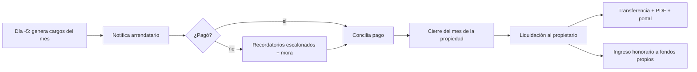

# Módulo 6 — Administración de propiedades (cartera arrendada)

Continúa de docs 01–04. Parte cuando el contrato de arriendo (doc 04) queda vigente y existe un **mandato de administración**.

---

## 1. Alcance
1. Mandato de administración y honorarios.
2. Cobros mensuales automáticos y estado de cuenta del arrendatario.
3. Pagos y conciliación.
4. Morosidad y cobranza.
5. Liquidación mensual al propietario (cuenta corriente).
6. Mantenciones y órdenes de trabajo.
7. Gastos de la propiedad (contribuciones, gastos comunes, seguros).
8. Inspecciones y vencimientos.

Fuera del MVP: pagos automáticos con tarjeta (PAC/PAT), cobro judicial, rendición de gastos comunes con la administración del edificio.

## 2. Flujo mensual



## 3. Modelo de datos

```sql
CREATE TABLE mandato_admin (          -- extiende 'mandato' tipo administracion (doc 03)
  mandato_id uuid PRIMARY KEY REFERENCES mandato,
  honorario_tipo text CHECK (honorario_tipo IN ('porcentaje_canon','monto_fijo','porcentaje_cobrado')),
  honorario_valor numeric(10,4) NOT NULL, honorario_minimo numeric(18,4), honorario_moneda moneda DEFAULT 'CLP',
  honorario_incluye_iva boolean DEFAULT false,
  cobra_honorario_si text CHECK (cobra_honorario_si IN ('devengado','solo_si_cobrado')) DEFAULT 'solo_si_cobrado',
  dia_liquidacion smallint DEFAULT 10, dia_transferencia smallint DEFAULT 12,
  monto_max_mantencion_sin_aprobacion numeric(18,4),   -- sobre esto requiere propietario
  retiene_fondo_reserva numeric(18,4) DEFAULT 0,       -- fondo para imprevistos
  cuenta_pago_propietario_id int,                      -- datos bancarios destino
  comision_mantencion_pct numeric(6,3) DEFAULT 0,
  paga_contribuciones boolean DEFAULT false, paga_gastos_comunes boolean DEFAULT false, seguro_obligatorio boolean DEFAULT false
);

CREATE TABLE cargo (
  id uuid PRIMARY KEY DEFAULT gen_random_uuid(), empresa_id uuid NOT NULL REFERENCES empresa,
  contrato_id uuid NOT NULL REFERENCES contrato_arriendo, propiedad_id uuid NOT NULL REFERENCES propiedad,
  arrendatario_id uuid NOT NULL REFERENCES persona, periodo char(7) NOT NULL,
  tipo text NOT NULL CHECK (tipo IN ('canon','gasto_comun','servicio_basico','multa','interes_mora','reparacion','garantia','proporcional','ajuste','otro')),
  descripcion text, monto_original numeric(18,4) NOT NULL, moneda moneda NOT NULL DEFAULT 'CLP',
  valor_indice numeric(18,6),                      -- UF del día de emisión si moneda=UF
  monto_clp numeric(18,4) NOT NULL, saldo_clp numeric(18,4) NOT NULL CHECK (saldo_clp >= 0),
  emision date NOT NULL, vencimiento date NOT NULL,
  estado text NOT NULL DEFAULT 'pendiente' CHECK (estado IN ('pendiente','parcial','pagado','vencido','anulado')),
  destino text CHECK (destino IN ('propietario','corredora','tercero')) DEFAULT 'propietario',  -- a quién pertenece lo cobrado
  origen text DEFAULT 'automatico', anulado_motivo text, UNIQUE (contrato_id, periodo, tipo, descripcion)
);
CREATE INDEX ON cargo (empresa_id, estado, vencimiento);

CREATE TABLE pago (
  id uuid PRIMARY KEY DEFAULT gen_random_uuid(), empresa_id uuid NOT NULL, arrendatario_id uuid NOT NULL REFERENCES persona,
  fecha date NOT NULL, monto numeric(18,4) NOT NULL CHECK (monto > 0), medio_pago_id int NOT NULL,
  referencia text, cuenta_bancaria_id int, cartola_linea_id uuid, comprobante_documento_id uuid,
  estado text DEFAULT 'registrado' CHECK (estado IN ('registrado','conciliado','rechazado','revertido')),
  movimiento_id uuid, sin_asignar numeric(18,4) DEFAULT 0, registrado_por uuid, created_at timestamptz DEFAULT now()
);
CREATE TABLE pago_aplicacion (        -- un pago puede cubrir varios cargos
  pago_id uuid REFERENCES pago, cargo_id uuid REFERENCES cargo, monto numeric(18,4) NOT NULL CHECK (monto > 0),
  PRIMARY KEY (pago_id, cargo_id)
);

CREATE TABLE cobranza_regla (
  id serial PRIMARY KEY, empresa_id uuid NOT NULL, dias_desde_vencimiento int NOT NULL,   -- -3, 1, 5, 10, 20, 30
  accion text CHECK (accion IN ('recordatorio','aviso_mora','carta_formal','derivar_legal','notificar_propietario')),
  canal text, plantilla_id int, activa boolean DEFAULT true
);
CREATE TABLE cobranza_gestion (
  id bigserial PRIMARY KEY, cargo_id uuid, contrato_id uuid NOT NULL, fecha timestamptz DEFAULT now(),
  accion text, canal text, resultado text, compromiso_pago date, detalle text, usuario_id uuid
);

CREATE TABLE liquidacion_propietario (
  id uuid PRIMARY KEY DEFAULT gen_random_uuid(), empresa_id uuid NOT NULL, propiedad_id uuid NOT NULL,
  propietario_id uuid NOT NULL REFERENCES persona, contrato_id uuid, periodo char(7) NOT NULL,
  ingresos numeric(18,4) NOT NULL DEFAULT 0, honorario_neto numeric(18,4) DEFAULT 0, honorario_iva numeric(18,4) DEFAULT 0,
  gastos numeric(18,4) DEFAULT 0, retenciones numeric(18,4) DEFAULT 0, saldo_anterior numeric(18,4) DEFAULT 0,
  neto_a_pagar numeric(18,4) NOT NULL,
  estado text DEFAULT 'borrador' CHECK (estado IN ('borrador','revisada','aprobada','pagada','anulada')),
  aprobada_por uuid, pagada_at timestamptz, movimiento_pago_id uuid, documento_id uuid,
  UNIQUE (propiedad_id, propietario_id, periodo)
);
CREATE TABLE liquidacion_propietario_detalle (
  id bigserial PRIMARY KEY, liquidacion_id uuid REFERENCES liquidacion_propietario,
  tipo text CHECK (tipo IN ('canon','gasto_comun_reembolsado','honorario','mantencion','contribucion','seguro','multa','interes','retencion','saldo','ajuste','otro')),
  descripcion text, monto numeric(18,4) NOT NULL,          -- + ingresa / − descuenta
  cargo_id uuid, movimiento_id uuid, documento_id uuid
);

-- Cuenta corriente por propietario (saldo a favor/en contra)
CREATE TABLE cuenta_corriente_propietario (
  id bigserial PRIMARY KEY, empresa_id uuid, propietario_id uuid, propiedad_id uuid, fecha date NOT NULL,
  descripcion text, debe numeric(18,4) DEFAULT 0, haber numeric(18,4) DEFAULT 0, movimiento_id uuid, liquidacion_id uuid
);

CREATE TABLE orden_trabajo (
  id uuid PRIMARY KEY DEFAULT gen_random_uuid(), empresa_id uuid NOT NULL, codigo text NOT NULL,
  propiedad_id uuid NOT NULL, contrato_id uuid, solicitante_persona_id uuid, origen text CHECK (origen IN ('arrendatario','propietario','inspeccion','corredora')),
  categoria text, prioridad text CHECK (prioridad IN ('baja','media','alta','urgente')) DEFAULT 'media',
  descripcion text NOT NULL, fotos text[], estado text DEFAULT 'solicitada' CHECK (estado IN
    ('solicitada','en_cotizacion','pendiente_aprobacion','aprobada','en_ejecucion','terminada','rechazada','cancelada')),
  responsable_id uuid, proveedor_id uuid, fecha_solicitud timestamptz DEFAULT now(), fecha_programada date, fecha_termino date,
  costo_estimado numeric(18,4), costo_real numeric(18,4), cargo_a text CHECK (cargo_a IN ('propietario','arrendatario','corredora')),
  aprobacion_propietario boolean, aprobacion_at timestamptz, movimiento_id uuid, evaluacion smallint,
  UNIQUE (empresa_id, codigo)
);
CREATE TABLE cotizacion (
  id bigserial PRIMARY KEY, orden_trabajo_id uuid REFERENCES orden_trabajo, proveedor_id uuid, monto numeric(18,4) NOT NULL,
  detalle text, plazo_dias int, documento_id uuid, elegida boolean DEFAULT false
);

CREATE TABLE gasto_recurrente (       -- contribuciones, gastos comunes, seguros
  id serial PRIMARY KEY, empresa_id uuid, propiedad_id uuid NOT NULL, concepto_id int NOT NULL,
  periodicidad text CHECK (periodicidad IN ('mensual','trimestral','semestral','anual')), monto_estimado numeric(18,4),
  moneda moneda DEFAULT 'CLP', proximo_vencimiento date, paga text CHECK (paga IN ('propietario','arrendatario')),
  gestiona_corredora boolean DEFAULT false, activo boolean DEFAULT true
);

CREATE TABLE inspeccion (
  id uuid PRIMARY KEY DEFAULT gen_random_uuid(), empresa_id uuid, propiedad_id uuid, contrato_id uuid,
  tipo text, programada date, realizada date, inspector_id uuid, acta_id uuid, hallazgos text, requiere_ot boolean
);
```

## 4. Reglas de negocio

### 4.1 Generación de cargos (job mensual)
1. Corre diariamente; para cada contrato `vigente`, 5 días (parámetro) antes del mes siguiente, crea cargo `canon` del periodo si no existe (idempotente por `UNIQUE`).
2. **Moneda UF:** `monto_clp = canon_uf × UF(fecha_emision)`; se guarda `valor_indice`.
3. **Primer y último mes** proporcionales según regla de contrato (doc 04 §C4).
4. **Reajuste aplicado:** si hay `contrato_reajuste` con `fecha_aplicacion ≤ periodo`, se usa el canon nuevo.
5. Otros cargos recurrentes (gasto común, servicios) se generan desde `gasto_recurrente` o se ingresan manualmente; reajustes manuales dejan registro.
6. Cargos **no se editan**: se anulan y se emite uno nuevo (con motivo), igual que en el libro de movimientos.

### 4.2 Pagos y conciliación
1. Medios: transferencia, depósito, webpay/pasarela (v1), efectivo en oficina (con comprobante y arqueo), cheque.
2. **Aplicación del pago:** por orden de antigüedad (cargos más viejos primero), con prioridad configurable: interés mora → multas → gastos comunes → canon. El usuario puede reasignar.
3. Pago mayor al saldo → `sin_asignar` queda como saldo a favor del arrendatario (anticipo).
4. Pago de cartola: sugerir por RUT/glosa/monto; coincidencia exacta con un cargo → auto-sugerencia, confirmación humana (v1 puede automatizar con umbral de confianza).
5. Al conciliar: crea `movimiento` (ingreso, `fondo='terceros'`, `pagador='cliente'`) enlazado a la operación del contrato. **El dinero cobrado de renta pertenece al propietario** (menos honorario).
6. Pagos rechazados o revertidos reabren el saldo de los cargos con auditoría.

### 4.3 Mora e intereses
1. Cargo pasa a `vencido` al día siguiente de `vencimiento + dias_gracia`.
2. **Interés y multa de mora** configurables por contrato (`multa_mora_pct`, `interes_mora_pct`); se calculan diariamente sobre saldo vencido y se materializan como cargo `interes_mora` al cierre del mes (o al pago).
3. Cobranza escalonada por `cobranza_regla`: p.ej. −3 días recordatorio, +1 aviso mora, +5 aviso mora con interés, +10 carta formal, +20 notificar propietario y sugerir acciones, +30 derivar a proceso legal (manual).
4. Cada gestión deja registro en `cobranza_gestion` con compromiso de pago si lo hay; si hay compromiso vigente se suspenden envíos automáticos.
5. **Aging** de cartera: 1-30, 31-60, 61-90, +90.
6. Los plazos y límites de intereses deben ajustarse al **marco legal vigente** (validar).

### 4.4 Honorario de administración
- Base: `porcentaje_canon` (sobre canon facturado) o `porcentaje_cobrado` (sobre lo efectivamente cobrado) o monto fijo; aplicar mínimo.
- `cobra_honorario_si = solo_si_cobrado` → el honorario nace al conciliar el pago, no al emitir el cargo.
- Genera movimiento ingreso propio con IVA según configuración; el egreso espejo reduce `fondo terceros` (traspaso a fondos propios al aprobar la liquidación).

### 4.5 Liquidación al propietario
Fórmula:
```
neto a pagar = Σ ingresos cobrados del período (canon y reembolsables)
             − honorario neto − IVA del honorario
             − gastos pagados por cuenta del propietario (mantenciones, contribuciones, seguros, otros)
             − retenciones aplicables (parámetro) − fondo de reserva a retener
             ± saldo anterior (si quedó en rojo o a favor)
```
Reglas:
1. Solo entran **pagos conciliados** del período; lo no cobrado no se liquida (se informa como deuda).
2. Si neto < 0, queda como **saldo por cobrar al propietario** arrastrado al mes siguiente (o se factura).
3. Estados: `borrador` (generada automáticamente) → `revisada` (Administrador) → `aprobada` (Finanzas) → `pagada`.
4. Aprobación bloqueada si hay movimientos sin respaldo o gastos pendientes de aprobación.
5. Al pagar: egreso `fondo='terceros'` al propietario; PDF a su portal y correo.
6. Múltiples propietarios: reparto por `porcentaje_dominio`, con una liquidación por propietario.
7. Propietario con varias propiedades: opción de **liquidación consolidada** (una transferencia, detalle por propiedad).
8. **Liquidación final** al término del mandato o contrato (incluye garantía si corresponde y gastos pendientes).

### 4.6 Mantenciones
1. **Origen:** solicitud del arrendatario (portal), propietario, inspección o corredora.
2. **Flujo:** solicitada → cotización (1–3 proveedores) → pendiente aprobación → aprobada → ejecución → terminada. **Urgencias** (fuga, gas, eléctrico) pueden saltarse la aprobación con registro y notificación posterior.
3. **Aprobación del propietario** si `costo ≥ monto_max_mantencion_sin_aprobacion` (mandato) o si el parámetro lo exige; se aprueba por portal/enlace con registro.
4. **Responsable del costo** (`cargo_a`): daño del arrendatario → cargo al arrendatario (genera `cargo` tipo `reparacion`) o descuento en garantía; desgaste normal → propietario; error de corredora → corredora (reduce utilidad).
5. **Costo real:** se ingresa al cerrar con factura de respaldo; genera `movimiento` egreso y detalle en la liquidación. Si difiere > X % de la cotización, requiere justificación.
6. **Comisión por mantención** opcional (porcentaje sobre costo) → ingreso propio.
7. Evaluación del proveedor (1–5) alimenta su calificación.

### 4.7 Gastos recurrentes y vencimientos
Contribuciones (cuotas trimestrales), seguros, gastos comunes: se generan alertas y, si `gestiona_corredora`, se paga desde fondos de terceros y se descuenta en la liquidación. Seguro vencido → alerta al propietario y a Gerente.

### 4.8 Inspecciones
Programadas (ej. cada 6 o 12 meses) → acta de inspección con fotos → hallazgos pueden crear OT. Resultado visible al propietario.

## 5. Eventos y vínculo con Finanzas

| Evento | Resultado |
|---|---|
| `cargo.emitido` | Provisión de cuenta por cobrar (sin movimiento financiero real) |
| `pago.conciliado` | Ingreso `terceros`; calcula honorario (si aplica) |
| `liquidacion.aprobada` | Traspaso honorario a propio; egreso al propietario |
| `ot.cerrada` | Egreso real, cargo al responsable |
| `contrato.terminado` | Liquidación final, devolución de garantía |
| `mora.superada_X_dias` | Notifica propietario y gerente |

Regla de oro: **nunca** pagar gastos propios con dinero `terceros`; la conciliación bancaria usa cuentas bancarias separadas (`cuenta_bancaria.fondo`).

## 6. Ejemplo numérico completo (propiedad de $600.000, honorario 7 % + IVA)

| Concepto | Monto |
|---|---|
| Canon cobrado | 600.000 |
| Gasto común reembolsable (cobrado) | 60.000 |
| **Ingresos del período** | **660.000** |
| Honorario 7 % sobre canon | −42.000 |
| IVA 19 % del honorario | −7.980 |
| Mantención (reparación calefón) | −85.000 |
| Contribuciones (cuota prorrateada) | −38.000 |
| **Neto a transferir al propietario** | **487.020** |

Utilidad de la corredora este mes = 42.000 (honorario neto) − costos internos asignados (8.000) = **34.000** (coincide con doc 03).
Mora: si el arrendatario paga 12 días tarde con interés mensual 1,5 %: interés ≈ 600.000 × 1,5 % × 12/30 = **3.600**, cargo `interes_mora`.

## 7. Pantallas
1. **Panel de cartera:** propiedades administradas, ocupación, cobrado vs esperado del mes, morosos.
2. **Estado de cuenta del contrato:** cargos, pagos, saldo, gestiones.
3. **Cobranza:** bandeja por aging, acción masiva (enviar recordatorio), registro de compromisos.
4. **Conciliación de pagos** (ver doc 03).
5. **Liquidaciones:** lista por periodo, vista previa PDF, revisión, aprobación masiva, nómina de transferencias.
6. **Órdenes de trabajo:** tablero por estado, cotizaciones comparadas, aprobación del propietario, galería de fotos.
7. **Gastos recurrentes y vencimientos.**
8. **Inspecciones** con acta móvil.
9. **Resumen por propietario** (cuenta corriente).

## 8. API
```
POST /api/mandatos-admin ; PATCH /api/mandatos-admin/{id}
GET  /api/cargos?contrato=&periodo=&estado=   POST /api/cargos (manual)   POST /api/cargos/{id}/anular
POST /api/jobs/generar-cargos {periodo}   (idempotente; también programado)
POST /api/pagos ; POST /api/pagos/{id}/aplicar ; POST /api/pagos/{id}/revertir
GET  /api/contratos-arriendo/{id}/estado-cuenta
GET  /api/cobranza?aging=  POST /api/cobranza/{contrato}/gestion
POST /api/liquidaciones-propietario/generar {periodo}   GET/PATCH /{id}   POST /{id}/revisar|aprobar|pagar
GET  /api/propietarios/{id}/cuenta-corriente
POST /api/ordenes-trabajo ; POST /{id}/cotizaciones ; POST /{id}/aprobar|rechazar|iniciar|terminar
GET/POST /api/gastos-recurrentes ; GET/POST /api/inspecciones
```

## 9. Jobs programados
| Job | Frecuencia | Notas |
|---|---|---|
| Generar cargos | Diario (5 días antes del mes) | Idempotente |
| Marcar vencidos y calcular mora | Diario | |
| Cobranza escalonada | Diario 09:00 | Respeta compromisos y horarios |
| Propuesta de reajustes | Diario | 30 días antes |
| Generar borradores de liquidación | Día `dia_liquidacion` | Por propietario |
| Alertas de vencimientos | Diario | seguros, contribuciones, contratos |
| Actualización de índices | Diario | UF, otros (doc 02 §A6) |

Cada job registra ejecución (inicio, fin, filas procesadas, errores) y notifica fallos.

## 10. Permisos
| Acción | Adm. propiedades | Finanzas | Gerente | Propietario | Arrendatario |
|---|---|---|---|---|---|
| Ver cartera | Propia | Todo | Todo | Sus propiedades | Su contrato |
| Emitir/anular cargo | ✔ | ✔ | ✔ | ✘ | ✘ |
| Registrar/conciliar pago | ✔ | ✔ | ✔ | ✘ | Informa pago |
| Aprobar liquidación | ✘ (revisa) | ✔ | ✔ | ✘ | ✘ |
| Crear OT / cotizar | ✔ | ✘ | ✔ | Solicita | Solicita |
| Aprobar OT sobre umbral | ✘ | ✘ | ✔ | ✔ | ✘ |

## 11. Criterios de aceptación
- Generar cargos dos veces el mismo mes no duplica nada.
- Un pago que cubre dos cargos se aplica por antigüedad y deja saldos correctos.
- La liquidación del ejemplo §6 da $487.020 y se puede reproducir desde detalle y movimientos.
- Pago desde fondos propios nunca se ve en cuentas de terceros (reporte de fondos cuadra).
- Una OT sobre el umbral no avanza a ejecución sin aprobación del propietario registrada.
- Cobranza respeta compromiso de pago (no envía recordatorio durante la vigencia).
- Liquidación aprobada es inmutable; cualquier corrección se refleja en la del mes siguiente como ajuste.

## 12. Riesgos y pendientes
- **Fondos de terceros:** estructura de cuentas bancarias y posibles obligaciones legales — validar con abogado/contador.
- **Mora, intereses y cobranza:** límites legales y formalidades (cartas, notificaciones) a validar.
- **Medios de pago online:** elegir pasarela y costo por transacción (¿quién lo asume? → concepto de egreso).
- **IVA del honorario y retenciones:** parámetros a confirmar con contador.
- **Gastos comunes:** integración con administradores de edificios fuera del MVP.

---

## Siguiente paso
Doc 06: **Publicación y difusión multicanal** + **Integraciones y notificaciones**.
