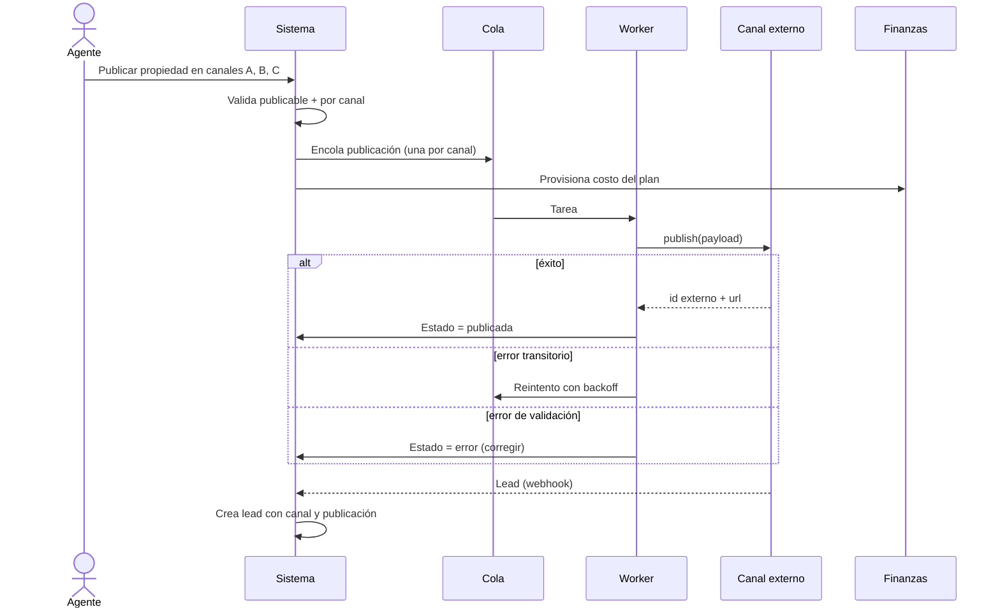
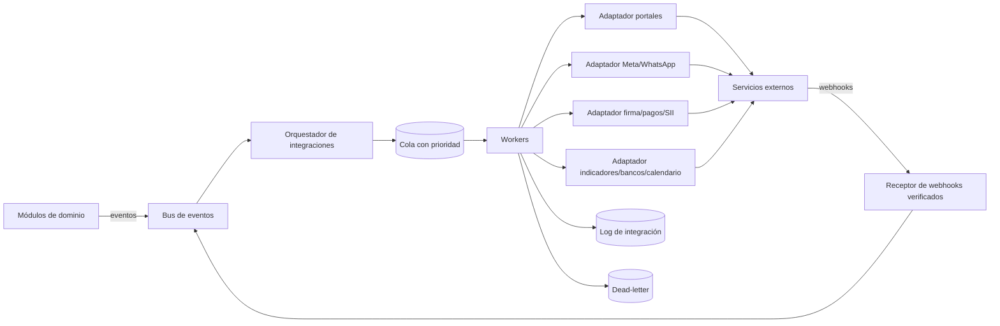

# Módulos 2 (Publicación y difusión) y 13 (Integraciones y notificaciones)

Continúa de docs 01–05. Ambos módulos comparten la infraestructura de **adaptadores**.

> **Advertencia de verificación:** en la investigación no se confirmó que Portal Inmobiliario, Yapo o Toctoc ofrezcan API pública. Todo lo marcado **[VALIDAR]** depende de acuerdos comerciales o de la documentación vigente de cada proveedor. El diseño garantiza que el sistema funciona aunque un canal solo permita publicación manual.

---

# PARTE A — PUBLICACIÓN Y DIFUSIÓN MULTICANAL

## A1. Canales

| Canal | Tipo | Modo de integración previsto | Estado |
|---|---|---|---|
| Sitio web propio | web | Nativo (páginas públicas, SEO, sitemap, JSON-LD) | MVP |
| Portal Inmobiliario | portal | API/feed/carga masiva **[VALIDAR]** → fallback: publicación asistida | v1 |
| Yapo, Toctoc, MercadoLibre Inmuebles, otros | portal | **[VALIDAR]** | v1–v2 |
| Instagram / Facebook | rrss | Meta Graph API (publicaciones, catálogo, Lead Ads) **[VALIDAR permisos y revisión de app]** | v2 |
| WhatsApp Business | mensajería | WhatsApp Business Platform (plantillas aprobadas) **[VALIDAR]** | v2 |
| Google Business Profile | web | API oficial **[VALIDAR]** | v2 |
| Email marketing | email | Proveedor transaccional/boletines | v1 |

### Modos de integración (por canal)
1. **API directa:** publicar/editar/retirar vía servicio.
2. **Feed:** el sistema expone un XML/JSON/CSV en una URL; el portal lo consume periódicamente.
3. **Carga masiva:** generar archivo para subir manualmente al portal.
4. **Publicación asistida:** el sistema entrega título, descripción y fotos listos para copiar; el agente pega y registra la URL/ID externo. Siempre disponible como respaldo.

## A2. Modelo de datos

```sql
-- canal y canal_plan ya definidos en doc 02 §A3
ALTER TABLE canal
  ADD COLUMN modo text CHECK (modo IN ('api','feed','carga_masiva','asistida','nativo')),
  ADD COLUMN config jsonb DEFAULT '{}',                       -- URLs, límites, campos requeridos (sin secretos)
  ADD COLUMN mapa_campos jsonb DEFAULT '{}',                  -- campo propio → campo del canal
  ADD COLUMN limites jsonb;                                   -- máx fotos, largo título, etc.

CREATE TABLE canal_credencial (        -- secretos cifrados por empresa
  id serial PRIMARY KEY, empresa_id uuid NOT NULL, canal_id int NOT NULL REFERENCES canal,
  tipo text, secreto_cifrado bytea NOT NULL, kms_key_ref text, expira_at timestamptz,
  estado text DEFAULT 'activa' CHECK (estado IN ('activa','por_expirar','expirada','revocada')),
  creado_por uuid, creado_at timestamptz DEFAULT now(), UNIQUE (empresa_id, canal_id, tipo)
);

CREATE TABLE publicacion (
  id uuid PRIMARY KEY DEFAULT gen_random_uuid(), empresa_id uuid NOT NULL REFERENCES empresa,
  propiedad_id uuid NOT NULL REFERENCES propiedad, operacion text NOT NULL CHECK (operacion IN ('venta','arriendo')),
  canal_id int NOT NULL REFERENCES canal, plan_id int REFERENCES canal_plan,
  estado_id int NOT NULL,                        -- pendiente, publicada, error, pausada, expirada
  id_externo text, url_externa text, titulo text, descripcion text,
  precio numeric(18,4), moneda moneda, destacada boolean DEFAULT false,
  publicada_at timestamptz, expira_at timestamptz, ultima_sync_at timestamptz,
  hash_contenido text,                           -- detecta cambios pendientes de sincronizar
  error_codigo text, error_detalle text, reintentos smallint DEFAULT 0,
  creada_por uuid, created_at timestamptz DEFAULT now(),
  UNIQUE (propiedad_id, operacion, canal_id)
);
CREATE INDEX ON publicacion (empresa_id, estado_id, expira_at);

CREATE TABLE publicacion_evento (       -- bitácora técnica por publicación
  id bigserial PRIMARY KEY, publicacion_id uuid NOT NULL, tipo text,
  solicitud jsonb, respuesta jsonb, http_status int, duracion_ms int, ok boolean, at timestamptz DEFAULT now()
);

CREATE TABLE publicacion_metrica (
  publicacion_id uuid, fecha date, vistas int DEFAULT 0, contactos int DEFAULT 0, favoritos int DEFAULT 0,
  clics int DEFAULT 0, impresiones int DEFAULT 0, costo_dia numeric(18,4) DEFAULT 0,
  PRIMARY KEY (publicacion_id, fecha)
);

CREATE TABLE plantilla_publicacion (
  id serial PRIMARY KEY, empresa_id uuid NOT NULL, canal_id int, tipo_propiedad_id int, operacion text,
  plantilla_titulo text, plantilla_descripcion text,          -- con variables {{dormitorios}}, {{comuna}}, {{precio}}
  hashtags text[], activa boolean DEFAULT true
);

CREATE TABLE campana_publicitaria (     -- pauta pagada (Meta, Google)
  id uuid PRIMARY KEY DEFAULT gen_random_uuid(), empresa_id uuid NOT NULL, canal_id int, propiedad_id uuid,
  nombre text, presupuesto numeric(18,4), moneda moneda, inicio date, fin date,
  estado text, id_externo text, gasto_acumulado numeric(18,4) DEFAULT 0, leads int DEFAULT 0
);
```

## A3. Reglas de negocio

1. **Publicable** (doc 03 §A3 regla 7): completitud, fotos mínimas, portada, mandato vigente, dominio 100 %. Cada canal puede exigir más (ej. superficie, m² útiles); el sistema valida contra `canal.config.campos_requeridos` y muestra los faltantes.
2. **Publicar una vez, distribuir a N canales:** el usuario elige canales y planes; se crea una `publicacion` por canal en `pendiente` y el worker las procesa en paralelo.
3. **Contenido por canal:** título y descripción desde `plantilla_publicacion` con variables; opción de **generar texto con IA** (se muestra para revisión humana, nunca se publica sin confirmar). Límites de largo y fotos se aplican por canal (`limites`).
4. **Sincronización de cambios:** al cambiar precio, estado, fotos o descripción, se recalcula `hash_contenido`; si difiere del publicado → `publicacion` marcada "desactualizada" y se encola actualización (inmediata o programada).
5. **Cambios de estado de propiedad:**
   - `reservada` → pausar (configurable) · `vendida/arrendada/retirada` → retirar de todos los canales y registrar evento.
   - Mandato vencido → bloquear nuevas publicaciones y alertar; publicaciones activas se pausan tras período de gracia (parámetro).
6. **Estados de publicación:** `pendiente → publicada → pausada/expirada`; `error` con código y detalle. Transiciones por mantenedor (doc 02 §A5).
7. **Reintentos:** hasta N (3) con backoff exponencial (1 min, 5 min, 30 min); errores de validación del canal **no** reintentan (requieren corrección). Tras agotar → `error` + alerta al agente y a Gerente.
8. **Duplicados:** no permitir dos publicaciones activas de la misma propiedad+operación en el mismo canal.
9. **Costos (integración Finanzas, doc 03 §B11):**
   - Al crear la publicación se **provisiona** el costo del `canal_plan` (editable con valor real); si hay concepto asociado, se imputa a propiedad/operación.
   - Pauta en Meta/Google: el gasto diario real (si hay API) se registra como movimiento acumulado por campaña; si no, se ingresa manualmente.
   - Si el costo lo asume el propietario (según mandato), `pagador='propietario'`.
10. **Leads entrantes:** cada publicación tiene un **identificador de seguimiento** (`ref=publicacion_id` en URL/teléfono/correo virtual/formulario) para atribuir el lead al canal; el lead hereda `canal_id`, `publicacion_id`, `utm` (doc 04 §A2).
11. **Expiración:** alerta 3 días antes de `expira_at`; opción de renovar (genera nuevo costo).
12. **Control de acceso:** solo usuarios con permiso `publicacion.crear` y alcance sobre la propiedad; destacados/pagados requieren aprobación sobre el umbral de gasto.

## A4. Sitio web propio (canal nativo)

- Listado y ficha pública con filtros (operación, tipo, comuna, precio, dormitorios), mapa y galería; formulario de contacto y botón WhatsApp (genera lead).
- **SEO:** URLs limpias (`/venta/departamento/providencia/codigo-slug`), `sitemap.xml`, metadatos, **JSON-LD** (`RealEstateListing`), imágenes optimizadas (WebP/AVIF, `srcset`), carga rápida.
- Páginas por comuna/tipo para posicionamiento.
- Solo expone datos publicables (nunca datos del propietario ni notas internas).
- Seguimiento de métricas (vistas, clics en contacto) con consentimiento de cookies.

## A5. Adaptador de canal — contrato

```ts
interface ChannelAdapter {
  code: string;                         // 'portalinmobiliario', 'meta', ...
  capabilities: { create: boolean; update: boolean; pause: boolean; withdraw: boolean;
                  metrics: boolean; leads: 'webhook'|'poll'|'none'; media: 'upload'|'url' };
  validate(listing: CanonicalListing): ValidationResult;          // campos faltantes, límites
  map(listing: CanonicalListing): ChannelPayload;                 // aplica mapa_campos
  publish(payload: ChannelPayload, ctx: Ctx): Promise<{externalId: string; url?: string}>;
  update(externalId: string, payload: ChannelPayload, ctx: Ctx): Promise<void>;
  pause(externalId: string, ctx: Ctx): Promise<void>;
  withdraw(externalId: string, ctx: Ctx): Promise<void>;
  fetchMetrics?(externalId: string, range: DateRange, ctx: Ctx): Promise<Metrics>;
  parseLeadWebhook?(req: Request): Promise<Lead[]>;
  health(ctx: Ctx): Promise<{ok: boolean; detail?: string}>;
}
// CanonicalListing: modelo único independiente del canal (propiedad + precio + textos + media + contacto)
// Errores tipados: ValidationError (no reintentar) | AuthError (marcar credencial) | RateLimited (esperar) | Transient (reintentar)
```
Un canal sin API se implementa como adaptador de modo `asistida` o `carga_masiva` (`publish` genera el paquete o archivo; el usuario confirma manualmente y registra el ID externo).

## A6. Flujo de publicación



## A7. Métricas y reportes
Por publicación y canal: vistas, contactos, favoritos, **tasa de contacto**, costo por vista y por lead, leads→visita→oferta, días en mercado, comparación entre canales. Sincronización diaria vía `fetchMetrics` si el canal lo permite; si no, ingreso manual. Alimenta reportes de rentabilidad (doc 03 §B7).

## A8. Pantallas
1. **Asistente de publicación:** elegir canales/planes, previsualización por canal, faltantes, costo estimado.
2. **Panel de publicaciones** por propiedad: estado, ID externo, última sincronización, errores, botones (reintentar, pausar, retirar, renovar).
3. **Plantillas de texto** y generador IA con revisión.
4. **Calendario de expiraciones.**
5. **Rendimiento por canal** (embudo + costo).
6. **Cola de publicación** (administrador): tareas, reintentos, errores.

## A9. API
```
POST /api/propiedades/{id}/publicaciones   {canales:[{canal_id,plan_id}], operacion}
GET  /api/publicaciones?estado=&canal=      PATCH /api/publicaciones/{id}
POST /api/publicaciones/{id}/sincronizar|pausar|retirar|renovar|reintentar
POST /api/publicaciones/{id}/confirmar-manual {id_externo,url}      (modo asistido)
GET  /api/publicaciones/{id}/eventos ; GET /api/publicaciones/{id}/metricas
GET  /public/feed/{canal}.xml?token=         (feeds para portales que lo consumen)
GET  /public/propiedades ; GET /public/propiedades/{slug} ; POST /public/contacto
POST /api/webhooks/{canal}                   (leads/estado desde canales)
```

## A10. Criterios de aceptación
- Publicar una propiedad en el sitio web propio y en un canal asistido en una sola acción; el costo se provisiona.
- Cambiar el precio marca todas las publicaciones como desactualizadas y las sincroniza.
- Cerrar una venta retira la propiedad de todos los canales automáticamente.
- Un error de validación de canal muestra el campo faltante y no reintenta; un error transitorio sí.
- Un lead llegado por webhook queda con canal y publicación de origen.
- Credenciales nunca aparecen en respuestas de API ni logs.

---

# PARTE B — INTEGRACIONES Y NOTIFICACIONES

## B1. Mapa de integraciones

| Integración | Uso | Prioridad | Estado de verificación |
|---|---|---|---|
| Indicadores económicos (UF, UTM, IPC, USD) | Reajustes, cargos, movimientos | MVP | Elegir fuente oficial **[VALIDAR]** |
| Correo transaccional (SMTP/API) | Notificaciones, liquidaciones | MVP | Estándar |
| Firma electrónica | Contratos, mandatos, actas | v1 | Elegir proveedor **[VALIDAR]** |
| Pasarela de pago (Webpay/otras) | Pago de arriendos en línea | v1 | **[VALIDAR]** costos y contrato |
| Cartolas bancarias | Conciliación | v1 | Archivo (Excel/CSV/OFX) primero; APIs bancarias **[VALIDAR]** |
| Facturación electrónica SII (vía proveedor) | Facturas/boletas de comisiones y honorarios | v2 | **[VALIDAR]** |
| Calendario (Google/Microsoft) | Visitas | v1 | API estándar |
| WhatsApp Business | Notificaciones, bandeja | v2 | **[VALIDAR]** plantillas y costos |
| Meta Lead Ads / Pixel | Leads y pauta | v2 | **[VALIDAR]** |
| Portales inmobiliarios | Publicación | v1–v2 | **[VALIDAR]** |
| Almacenamiento de archivos | Fotos, documentos | MVP | Estándar (objeto cifrado) |
| Mapas/geocodificación | Dirección, mapa | v1 | Proveedor a elegir |

## B2. Arquitectura de integración



## B3. Modelo de datos

```sql
CREATE TABLE integracion (
  id serial PRIMARY KEY, empresa_id uuid NOT NULL, codigo text NOT NULL, nombre text, tipo text,
  activa boolean DEFAULT true, config jsonb DEFAULT '{}', credencial_id int, ultimo_exito_at timestamptz,
  ultimo_error_at timestamptz, estado text DEFAULT 'ok' CHECK (estado IN ('ok','degradada','caida','sin_configurar')),
  UNIQUE (empresa_id, codigo)
);
CREATE TABLE integracion_log (
  id bigserial PRIMARY KEY, empresa_id uuid, integracion_id int, direccion text CHECK (direccion IN ('saliente','entrante')),
  operacion text, correlacion_id uuid, entidad text, entidad_id uuid,
  solicitud_resumen jsonb, respuesta_resumen jsonb,           -- datos sensibles enmascarados
  http_status int, ok boolean, duracion_ms int, intento smallint, error text, at timestamptz DEFAULT now()
);
CREATE INDEX ON integracion_log (empresa_id, integracion_id, at DESC);

CREATE TABLE webhook_entrante (
  id uuid PRIMARY KEY DEFAULT gen_random_uuid(), integracion_codigo text, recibido_at timestamptz DEFAULT now(),
  firma_valida boolean, idempotency_key text UNIQUE, payload jsonb, procesado boolean DEFAULT false, error text
);
CREATE TABLE tarea_integracion (        -- cola persistente (si no se usa solo broker)
  id uuid PRIMARY KEY DEFAULT gen_random_uuid(), empresa_id uuid, integracion_codigo text, tipo text, payload jsonb,
  estado text DEFAULT 'pendiente' CHECK (estado IN ('pendiente','en_proceso','ok','error','muerta')),
  intentos smallint DEFAULT 0, proximo_intento_at timestamptz, idempotency_key text UNIQUE, prioridad smallint DEFAULT 5, ultimo_error text
);

-- Notificaciones
CREATE TABLE notificacion (
  id uuid PRIMARY KEY DEFAULT gen_random_uuid(), empresa_id uuid NOT NULL, evento text NOT NULL,
  destinatario_usuario_id uuid, destinatario_persona_id uuid, canal text NOT NULL CHECK (canal IN ('email','whatsapp','sms','push','interna')),
  plantilla_id int, asunto text, cuerpo text, variables jsonb, adjuntos uuid[],
  estado text DEFAULT 'pendiente' CHECK (estado IN ('pendiente','enviada','entregada','leida','fallida','omitida')),
  motivo_omision text, programada_at timestamptz, enviada_at timestamptz, externo_id text, intentos smallint DEFAULT 0
);
CREATE TABLE preferencia_notificacion (
  usuario_id uuid, persona_id uuid, evento text, canal text, activa boolean DEFAULT true, horario_inicio time, horario_fin time,
  PRIMARY KEY (usuario_id, persona_id, evento, canal)
);
```

## B4. Reglas y estándares

1. **Adaptador por integración** con el mismo contrato (health, operaciones tipadas, errores tipados). Cambiar de proveedor no afecta el dominio.
2. **Idempotencia:** toda tarea saliente lleva `idempotency_key` (ej. `publicar:{publicacion_id}:{hash}`); webhooks entrantes se deduplican por `idempotency_key`.
3. **Reintentos y backoff:** exponencial con jitter; límites por integración respetando *rate limits*; **circuit breaker**: si falla N veces seguidas se marca `degradada/caida`, se pausa la cola y se alerta.
4. **Dead-letter:** tareas agotadas pasan a `muerta` y se muestran en un panel con acción "reintentar" o "descartar" (con motivo).
5. **Webhooks entrantes:** verificar firma/secreto, responder rápido (202) y procesar de forma asíncrona; registrar siempre.
6. **Secretos:** cifrados (KMS), por empresa, rotación y expiración con alertas; nunca en logs ni respuestas; mínimo privilegio.
7. **Enmascaramiento** de datos personales y financieros en logs.
8. **Correlación:** `correlacion_id` atraviesa evento → tarea → llamada → webhook para trazar de punta a punta.
9. **Health checks** periódicos por integración y panel de estado (ok/degradada/caída) con último éxito.
10. **Contingencia:** cada integración crítica define **modo manual** (ej. cargar UF a mano; publicar asistido; conciliar por Excel; registrar firma subiendo PDF). El sistema nunca debe quedar bloqueado por un tercero.
11. **Versionado:** cada adaptador registra versión de API del tercero; alertas de cambios/deprecaciones.
12. **Cumplimiento:** respetar términos de uso de cada plataforma (no *scraping*, no automatizaciones prohibidas); datos enviados limitados a lo necesario.

## B5. Notificaciones multicanal

**Eventos y plantillas** (ejemplos): lead asignado · visita agendada/recordatorio/reagendada · oferta recibida · hito de operación · mandato por vencer · cargo emitido · recordatorio de pago/mora · pago recibido · liquidación disponible · OT creada/cotizada/aprobada · reajuste próximo · contrato por vencer · documento por firmar/firmado · error de integración.

**Reglas:**
1. Cada evento define canales posibles y plantilla por canal (mantenedor `plantilla_notificacion`, doc 02), con variables validadas y vista previa.
2. **Preferencias** por usuario/persona; las transaccionales obligatorias (contrato, cobro) no se pueden desactivar; marketing exige consentimiento (doc 04 §A3.7).
3. **Horarios:** no enviar fuera del horario permitido (parámetro); se programa para la siguiente ventana.
4. **WhatsApp:** solo mensajes iniciados por la empresa mediante plantillas aprobadas **[VALIDAR]**; respuesta libre dentro de la ventana permitida por la plataforma.
5. **Fallback:** si el canal preferido falla → siguiente canal definido (ej. WhatsApp → email).
6. **Agrupación (digest)** para evitar spam al agente (ej. resumen diario de tareas).
7. **Registro y trazabilidad:** estado enviada/entregada/leída/fallida; reintentos limitados; `omitida` con motivo (sin consentimiento, fuera de horario, duplicada).
8. **Deduplicación:** misma notificación al mismo destinatario dentro de una ventana → se omite.
9. Documentos adjuntos (liquidación, contrato) por enlace seguro con expiración, no como adjunto abierto cuando contienen datos sensibles.

## B6. Integraciones prioritarias — detalle de contrato

**Indicadores (MVP):** `GET índice(codigo, fecha)` con respaldo local; precarga mensual de UF; alerta si el valor del día no existe. Fallback: carga manual con respaldo (doc 02 §A6).

**Firma electrónica (v1):** crear solicitud con documento + firmantes (rol, orden, RUT, email/teléfono) → recibir webhook `firmado/rechazado/expirado` → guardar PDF firmado y certificado/evidencia, actualizar estado del documento y costo asociado (doc 03). Tipos de firma (simple/avanzada) según el acto jurídico **[VALIDAR con abogado]**.

**Pasarela de pago (v1):** crear orden de pago desde estado de cuenta → redirección → webhook de confirmación → `pago` conciliado automáticamente y cargo aplicado; costo de comisión de pasarela como egreso (¿quién lo asume?).

**Cartolas (v1):** parsers por banco (CSV/Excel/OFX); definir bancos objetivo; hash por línea evita duplicados (doc 03 §B2).

**Facturación SII (v2):** emisión por proveedor certificado desde comisiones/honorarios; guardar folio, XML/PDF y estado; notas de crédito por anulación **[VALIDAR]**.

## B7. Pantallas
1. **Estado de integraciones** (semáforo, último éxito/error, botón probar conexión).
2. **Configuración por integración** (credenciales enmascaradas, parámetros, mapeos).
3. **Log de integración** con filtros por correlación, entidad y estado; ver solicitud/respuesta enmascaradas.
4. **Cola y dead-letter:** reintentar / descartar.
5. **Centro de notificaciones:** historial, plantillas, preferencias, pruebas de envío.
6. **Webhooks recibidos** (diagnóstico).

## B8. API
```
GET  /api/integraciones ; PATCH /api/integraciones/{codigo} ; POST /api/integraciones/{codigo}/probar
PUT  /api/integraciones/{codigo}/credenciales   (solo escritura; nunca devuelve el secreto)
GET  /api/integraciones/logs?correlacion=&entidad=   POST /api/integraciones/logs/{id}/reintentar
GET  /api/integraciones/cola ; POST /api/integraciones/cola/{id}/reintentar|descartar
POST /api/webhooks/{integracion}     (público, verificado por firma)
GET  /api/notificaciones ; POST /api/notificaciones/prueba
GET/PUT /api/preferencias-notificacion
```

## B9. Criterios de aceptación
- Una caída del proveedor de firma deja las tareas en reintento sin perder datos ni duplicar solicitudes al recuperarse.
- Un webhook repetido no duplica el pago ni el lead.
- Con la fuente de indicadores caída, el administrador carga la UF manualmente y el sistema continúa.
- Ninguna credencial es legible por API, log o usuario no autorizado.
- Una notificación a persona sin consentimiento de marketing queda `omitida` con motivo.
- Seguir el `correlacion_id` desde un evento hasta la llamada externa y su respuesta.

## B10. Riesgos
| Riesgo | Mitigación |
|---|---|
| Sin API en portales clave | Modo asistido/feed; acuerdos comerciales; priorizar sitio propio y Meta |
| Cambios de API/ToS de terceros | Adaptadores aislados, versionado y alertas |
| Costos de WhatsApp/pasarela/firma | Registrar como egresos y trasladar según política |
| Datos personales hacia terceros | Minimizar, contratos de encargo, registro de transferencias |
| Dependencia de un proveedor | Interfaz común + modo manual de contingencia |

---

## Siguiente paso
Doc 07: **Documentos y firma**, **Portales de cliente** y **Reportes/BI**.
