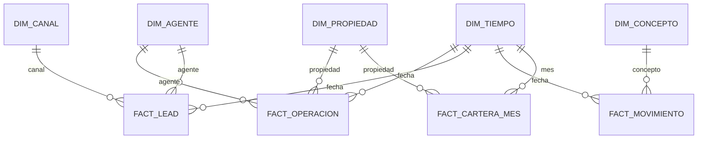

# Módulos 8 (Documentos y firma), 9 (Portales de cliente) y 10 (Reportes y BI)

Cierra el diseño por módulos. Continúa de docs 01–06.

---

# PARTE A — DOCUMENTOS Y FIRMA

## A1. Alcance
Repositorio único para todo documento (propiedad, persona, operación, contrato, movimiento), con tipos y vencimientos, plantillas con variables, generación de PDF, versionado, firma electrónica con trazabilidad, y registro del **costo** de cada documento en Finanzas.

## A2. Modelo de datos

```sql
CREATE TABLE documento (
  id uuid PRIMARY KEY DEFAULT gen_random_uuid(), empresa_id uuid NOT NULL REFERENCES empresa,
  tipo_documento_id int NOT NULL,                              -- mantenedor (doc 02)
  titulo text NOT NULL, descripcion text,
  entidad text NOT NULL CHECK (entidad IN ('propiedad','persona','operacion','contrato','movimiento','mandato','orden_trabajo','general')),
  entidad_id uuid, version_actual int NOT NULL DEFAULT 1,
  estado text NOT NULL DEFAULT 'borrador' CHECK (estado IN ('borrador','generado','pendiente_firma','firmado','vigente','vencido','anulado')),
  confidencialidad text DEFAULT 'interno' CHECK (confidencialidad IN ('publico','interno','restringido')),
  fecha_emision date, fecha_vencimiento date,
  plantilla_id int, generado_automaticamente boolean DEFAULT false,
  hash_sha256 text, bytes bigint, mime text,
  visible_propietario boolean DEFAULT false, visible_arrendatario boolean DEFAULT false, visible_comprador boolean DEFAULT false,
  creado_por uuid, created_at timestamptz DEFAULT now(), deleted_at timestamptz
);
CREATE INDEX ON documento (empresa_id, entidad, entidad_id);
CREATE INDEX ON documento (empresa_id, fecha_vencimiento) WHERE fecha_vencimiento IS NOT NULL;

CREATE TABLE documento_version (
  id uuid PRIMARY KEY DEFAULT gen_random_uuid(), documento_id uuid NOT NULL REFERENCES documento, version int NOT NULL,
  archivo_ref text NOT NULL, hash_sha256 text NOT NULL, bytes bigint, mime text,
  cambio text, subido_por uuid, subido_at timestamptz DEFAULT now(), UNIQUE (documento_id, version)
);

CREATE TABLE documento_acceso_log (     -- quién vio/descargó
  id bigserial PRIMARY KEY, documento_id uuid, usuario_id uuid, persona_id uuid, accion text CHECK (accion IN ('ver','descargar','compartir','firmar')),
  ip inet, at timestamptz DEFAULT now()
);

CREATE TABLE plantilla_documento (
  id serial PRIMARY KEY, empresa_id uuid NOT NULL, tipo_documento_id int NOT NULL, nombre text NOT NULL,
  contenido text NOT NULL,                     -- HTML/Markdown con variables {{...}} y bloques condicionales
  variables_def jsonb,                         -- variables requeridas, tipo y origen de datos
  version int DEFAULT 1, activa boolean DEFAULT true, revisada_legal_at date, revisada_por text,
  encabezado text, pie text, created_at timestamptz DEFAULT now()
);

CREATE TABLE solicitud_firma (
  id uuid PRIMARY KEY DEFAULT gen_random_uuid(), empresa_id uuid NOT NULL, documento_id uuid NOT NULL REFERENCES documento,
  version int NOT NULL, proveedor text, id_externo text, tipo_firma text CHECK (tipo_firma IN ('simple','avanzada','manuscrita_digital','presencial')),
  orden_secuencial boolean DEFAULT false, expira_at timestamptz, mensaje text,
  estado text DEFAULT 'borrador' CHECK (estado IN ('borrador','enviada','parcial','completada','rechazada','expirada','cancelada')),
  documento_firmado_version int, evidencia_ref text, costo numeric(18,4), movimiento_id uuid,
  creada_por uuid, created_at timestamptz DEFAULT now(), completada_at timestamptz
);
CREATE TABLE firmante (
  id uuid PRIMARY KEY DEFAULT gen_random_uuid(), solicitud_id uuid NOT NULL REFERENCES solicitud_firma,
  persona_id uuid REFERENCES persona, usuario_id uuid REFERENCES usuario,
  nombre text NOT NULL, rut text, email text, telefono text, rol text,            -- propietario, arrendatario, aval, corredor...
  orden smallint DEFAULT 1, estado text DEFAULT 'pendiente' CHECK (estado IN ('pendiente','enviado','visto','firmado','rechazado','expirado')),
  firmado_at timestamptz, ip inet, user_agent text, motivo_rechazo text
);
```

## A3. Reglas de negocio

1. **Tipos documentales (mantenedor):** definen a qué entidades aplican, si vencen, días de alerta, si son obligatorios en una etapa, si requieren firma y su concepto de costo.
2. **Inmutabilidad de lo firmado:** un documento `firmado` no se modifica; cambios generan **nueva versión** o documento nuevo (adenda). Se guarda hash SHA-256 de cada versión.
3. **Versionado:** subir archivo crea `documento_version`; se conserva el historial, la versión vigente es la última aprobada.
4. **Generación desde plantilla:**
   - Variables resueltas desde las entidades (propiedad, partes, montos, fechas, comisión, canon, reajuste, garantía).
   - Validación previa: si falta una variable requerida, se informa antes de generar.
   - Montos con formato local (CLP con separador de miles; UF con decimales), fechas en texto y número; **moneda y valor UF del día** impresos cuando aplique.
   - El PDF resultante es una versión del documento con referencia a la **versión de plantilla** usada.
   - Las plantillas jurídicas deben ser **revisadas por un abogado**; se guarda quién y cuándo (`revisada_legal_at`); plantillas sin revisión muestran advertencia.
5. **Firma electrónica:**
   - Se solicita sobre una versión concreta; firmantes y orden definidos; link único por firmante con expiración.
   - Estados sincronizados por webhook (doc 06 §B6). Al completar: se guarda PDF firmado + evidencia (certificado/registro), el documento pasa a `firmado` y se dispara el evento (`documento.firmado`) que puede avanzar el checklist de la operación (doc 04 §B3) o activar el contrato (doc 04 §C3).
   - Rechazo/expiración notifica al agente y deja la operación en espera.
   - Tipo de firma exigido por tipo de documento (p. ej. actos que requieren escritura pública quedan fuera del sistema y solo se registra su inscripción). **[VALIDAR con abogado]**
6. **Vencimientos:** job diario crea alertas según `fecha_vencimiento` y `dias_alerta`; documento vencido no cuenta como cumplido en checklists.
7. **Obligatoriedad:** los tipos `obligatorio_en` bloquean avance de etapa si faltan (doc 04). Excepción solo con permiso.
8. **Visibilidad por portal:** por defecto `interno`; el usuario marca qué se comparte con propietario/arrendatario/comprador. Documentos con datos de terceros (informes comerciales, cédulas) nunca se comparten por defecto.
9. **Seguridad:** almacenamiento cifrado; descargas por URL firmada de corta duración; registro de acceso; marca de agua opcional en visualizaciones; antivirus/validación de tipo al subir; límite de tamaño y tipos permitidos (PDF, JPG/PNG, DOCX, XLSX).
10. **Costo del documento → Finanzas:** si el tipo o la solicitud tiene costo (firma, notaría, certificado), se crea movimiento egreso **provisionado** con el valor referencial, editable al valor real, con el documento como respaldo y el pagador definido (doc 03 §B2, §B11).
11. **Retención:** por tipo (años), anonimización/eliminación cuando corresponda y no exista obligación legal; borrado lógico y bloqueo si el documento respalda un movimiento financiero.
12. **OCR (opcional, v2):** extrae texto para búsqueda; datos extraídos se **proponen**, no se aceptan automáticamente.

## A4. Catálogo inicial de plantillas
Mandato de venta · Mandato de arriendo · Mandato de administración · Oferta de compra · Reserva · Promesa de compraventa (borrador de apoyo) · Contrato de arriendo · Anexo/renovación · Acta de entrega · Acta de restitución · Liquidación de garantía · Liquidación al propietario · Liquidación de comisiones a agente · Carta de cobranza (por etapa) · Aviso de reajuste · Autorización de visita · Consentimiento de datos personales · Orden de trabajo.

## A5. Pantallas
1. **Repositorio** con filtros (tipo, entidad, estado, vencimiento), búsqueda, vista previa.
2. **Ficha de documento:** versiones, firmantes, accesos, movimientos de costo asociados.
3. **Generador:** elegir plantilla → completar/validar variables → previsualizar → generar.
4. **Editor de plantillas** (variables, condicionales, revisión legal).
5. **Estado de firmas:** tablero pendiente/parcial/completo, recordatorios.
6. **Documentos por vencer.**
7. **Carga masiva de documentos** (arrastrar varios, clasificar).

## A6. API
```
GET/POST /api/documentos ; GET /api/documentos/{id} ; POST /api/documentos/{id}/versiones
GET  /api/documentos/{id}/descargar   → URL firmada temporal
POST /api/documentos/generar   {plantilla_id, entidad, entidad_id, variables?}   → documento borrador
POST /api/documentos/{id}/solicitar-firma {firmantes:[...], tipo_firma, expira_at}
POST /api/solicitudes-firma/{id}/recordar|cancelar ; webhook /api/webhooks/firma
GET/POST /api/plantillas-documento ; POST /api/plantillas-documento/{id}/previsualizar
```

## A7. Criterios de aceptación
- Generar un contrato de arriendo desde plantilla con datos reales y obtener un PDF correcto, indicando la versión de plantilla.
- Un documento firmado no puede editarse; modificarlo crea nueva versión con su hash.
- Completar la firma activa el contrato y avanza el checklist sin intervención manual.
- Documento con fecha de vencimiento genera alerta en el plazo definido.
- Costo de firma queda provisionado en Finanzas con el documento como respaldo.
- Descarga de documento restringido queda registrada y la URL expira.

---

# PARTE B — PORTALES DE CLIENTE

## B1. Portales y usuarios

| Portal | Quién | Propósito |
|---|---|---|
| **Propietario** | Dueños de propiedades administradas o en venta/arriendo | Transparencia: estado, visitas, ofertas, liquidaciones, aprobaciones |
| **Arrendatario** | Titular del contrato | Estado de cuenta, pago en línea, solicitudes, contrato |
| **Comprador** | Cliente con operación de venta | Favoritos, visitas, avance de su operación, documentos |
| (v2) **Proveedor** | Maestros/proveedores | Recibir OT y cotizar |

## B2. Autenticación y seguridad
- Cuentas separadas de los usuarios internos (`cuenta_portal`) vinculadas a `persona`; correo verificado o **enlace mágico** + 2FA opcional (obligatorio para aprobar pagos/liquidaciones).
- **Alcance estricto por vínculo:** el propietario solo ve propiedades donde figura en `propiedad_propietario` vigente; el arrendatario solo su contrato vigente (y el histórico propio); el comprador solo sus operaciones.
- Aislamiento por RLS usando el `persona_id` del token + `empresa_id`.
- Limitación de intentos, expiración de sesión, registro de accesos, enlaces de un solo uso para documentos.
- Consentimiento y política de privacidad visibles en el primer ingreso.
- **Datos nunca expuestos:** notas internas, comisiones de agentes, otros clientes, datos de scoring/informes de terceros (salvo lo propio), costos internos de la corredora.

```sql
CREATE TABLE cuenta_portal (
  id uuid PRIMARY KEY DEFAULT gen_random_uuid(), empresa_id uuid NOT NULL, persona_id uuid NOT NULL REFERENCES persona,
  email citext NOT NULL, tipo text[] NOT NULL,                  -- {propietario,arrendatario,comprador}
  password_hash text, totp_secret text, email_verificado boolean DEFAULT false,
  ultimo_acceso timestamptz, activa boolean DEFAULT true, UNIQUE (empresa_id, email)
);
CREATE TABLE solicitud_portal (       -- solicitudes de clientes (mantención, consulta, cambio de datos)
  id uuid PRIMARY KEY DEFAULT gen_random_uuid(), empresa_id uuid NOT NULL, cuenta_id uuid NOT NULL REFERENCES cuenta_portal,
  tipo text CHECK (tipo IN ('mantencion','consulta','pago_informado','cambio_datos','termino_contrato','visita','otro')),
  entidad text, entidad_id uuid, asunto text, detalle text, adjuntos uuid[],
  estado text DEFAULT 'recibida' CHECK (estado IN ('recibida','en_gestion','resuelta','cerrada')),
  ot_id uuid, asignada_a uuid, created_at timestamptz DEFAULT now()
);
CREATE TABLE mensaje_portal (
  id bigserial PRIMARY KEY, solicitud_id uuid REFERENCES solicitud_portal, autor_cuenta_id uuid, autor_usuario_id uuid,
  cuerpo text NOT NULL, adjuntos uuid[], at timestamptz DEFAULT now(), leido_at timestamptz
);
```

## B3. Portal del propietario

| Sección | Contenido |
|---|---|
| Inicio | Resumen de todas sus propiedades, pendientes de aprobación, últimos movimientos |
| Mis propiedades | Estado, fotos, precio/canon, contrato vigente, ocupación |
| Venta/arriendo en curso | Publicaciones activas y **métricas** (vistas, contactos), visitas realizadas y feedback (sin datos personales innecesarios), ofertas recibidas con opción **aceptar / rechazar / contraofertar** (si el mandato lo permite) |
| Finanzas | **Liquidaciones** mensuales (PDF y detalle), cuenta corriente, pagos recibidos, honorarios, gastos, comprobantes |
| Mantenciones | Cotizaciones comparadas y botón **aprobar / rechazar**, avance y fotos |
| Documentos | Los marcados como visibles (mandato, contrato, actas, certificados) |
| Comunicación | Mensajes con su ejecutivo y solicitudes |
| Alertas | Contrato por vencer, reajuste, seguro, contribuciones |

Reglas: aprobaciones con registro (quién, cuándo, IP) y 2FA si superan umbral; aprobaciones vencidas notifican; los montos se muestran en la moneda del contrato con equivalente CLP del día cuando aplique.

## B4. Portal del arrendatario

| Sección | Contenido |
|---|---|
| Inicio | Saldo, próximo vencimiento, estado de solicitudes |
| Estado de cuenta | Cargos, pagos, saldo, intereses; descarga de comprobantes |
| **Pagar** | Pago en línea (pasarela, v1) o **informar transferencia** con comprobante (queda `registrado` hasta conciliar) |
| Contrato | Vista y PDF, fechas clave, reajustes y avisos |
| Solicitudes | Mantenciones (con fotos) y consultas; seguimiento de OT |
| Documentos | Contrato, actas, avisos |
| Aviso de término | Formulario con plazos calculados según contrato |

Reglas: el pago informado no libera el cargo hasta conciliar; el portal muestra el estado "en revisión". No ve costos internos ni datos del propietario más allá de lo necesario (nombre/contacto autorizado).

## B5. Portal del comprador

| Sección | Contenido |
|---|---|
| Favoritos y búsquedas guardadas | Alimenta `demanda` (doc 04) con alertas de nuevas coincidencias |
| Visitas | Agendadas, reprogramar/cancelar, feedback |
| Mi operación | Línea de tiempo (oferta → reserva → promesa → escritura → inscripción), checklist con documentos que debe aportar (subir desde el portal) |
| Documentos | Solo los del comprador y los marcados como visibles |
| Mensajes | Con su agente |

Reglas: no ve información del vendedor ni comisiones; subidas de documentos pasan a estado "por revisar".

## B6. Notificaciones y PWA
Todas las novedades relevantes se notifican por email/WhatsApp (doc 06 §B5) con enlace profundo al portal. Interfaz **responsive/PWA** (móvil primero), accesibilidad (WCAG AA), idioma español de Chile.

## B7. API (prefijo `/portal`)
```
POST /portal/auth/enlace-magico | /login | /2fa
GET  /portal/propietario/propiedades | /liquidaciones | /ofertas | /mantenciones
POST /portal/propietario/ofertas/{id}/responder    POST /portal/propietario/ot/{id}/aprobar|rechazar
GET  /portal/arrendatario/contrato | /estado-cuenta
POST /portal/arrendatario/pagos (inicia pasarela) | /pagos/informar | /solicitudes | /termino
GET  /portal/comprador/operaciones | /favoritos ; POST /portal/comprador/documentos ; POST /portal/comprador/visitas
GET/POST /portal/solicitudes ; GET/POST /portal/solicitudes/{id}/mensajes
GET  /portal/documentos/{id}/descargar
```

## B8. Criterios de aceptación
- Un propietario nunca accede a datos de otra propiedad (prueba automatizada de autorización por vínculo).
- Aprobar una mantención sobre umbral exige 2FA y deja registro; desbloquea la OT.
- Un pago informado por el arrendatario no cambia el saldo hasta conciliar.
- Una liquidación aprobada aparece en el portal del propietario con su PDF y su detalle reproducible.
- Los datos internos (comisiones, notas, costos) nunca aparecen en ninguna respuesta de `/portal`.

---

# PARTE C — REPORTES Y BI

## C1. Principios
1. **Una definición por métrica** (diccionario de datos) para que todos los reportes den el mismo número.
2. Reportes operativos sobre vistas SQL; analíticos sobre **vistas materializadas** refrescadas por job.
3. Todo reporte respeta alcance (empresa → sucursal → equipo → propio) y permisos; exportación con auditoría.
4. Cada reporte: métrica, fórmula, dimensiones, filtros, roles, frecuencia de refresco, exportación (Excel/PDF), y gráfico recomendado.

## C2. Modelo dimensional (resumen)



| Tabla | Grano | Medidas clave |
|---|---|---|
| `fact_lead` | un lead | cantidad, tiempo primera respuesta, convertido, costo asignado |
| `fact_visita` | una visita | realizada, no asistió, interés |
| `fact_operacion` | una operación | precio cierre, comisión bruta, comisión agentes, costos corredora, utilidad, días de ciclo |
| `fact_movimiento` | un movimiento | monto neto, IVA, total, monto CLP, signo |
| `fact_publicacion_dia` | publicación/día | vistas, contactos, costo |
| `fact_cartera_mes` | propiedad administrada/mes | canon, cobrado, mora, honorario, vacancia, gastos |
| `fact_comision_agente` | reparto | monto, estado |

## C3. Catálogo de reportes

### Comercial
| # | Reporte | Fórmula / definición | Dimensiones |
|---|---|---|---|
| R1 | Embudo de leads | leads por etapa y % paso a etapa siguiente | fuente, canal, agente, periodo |
| R2 | Tiempo de respuesta | prom./mediana (`primer_contacto_at − asignado_at`) y % dentro de SLA | agente, canal |
| R3 | Conversión por canal | operaciones cerradas / leads del canal | canal, campaña |
| R4 | Visitas y feedback | visitas realizadas, no asistencia, interés prom. | propiedad, agente |
| R5 | Tiempo en el mercado | días entre publicación y reserva/cierre | tipo, comuna, rango precio |
| R6 | Forecast de cierres | Σ (comisión esperada × probabilidad de etapa) | agente, mes |
| R7 | Cartera de propiedades | por estado, antigüedad, precio vs mercado, mandatos por vencer | sucursal, agente |

### Financiero (ver doc 03 §B7)
| # | Reporte | Fórmula / definición |
|---|---|---|
| R8 | Resultado por operación | ingresos − costos corredora − comisiones a agentes |
| R9 | Rentabilidad por agente/sucursal/canal/tipo | utilidad y margen % agregados |
| R10 | Comisiones | devengadas, aprobadas, pagadas, por cobrar al cliente |
| R11 | Flujo de caja proyectado | cobros y pagos por vencimiento (12 semanas/12 meses) |
| R12 | Presupuesto vs real | por centro de costo y concepto |
| R13 | Cuentas por cobrar/pagar con aging | 0-30, 31-60, 61-90, +90 |
| R14 | Movimientos sin respaldo / sin conciliar / vencidos | listado de control |
| R15 | Libro IVA y exportación contable | por periodo |
| R16 | **Costo de adquisición** | (publicidad + captación) / operaciones cerradas; costo por lead |

### Administración de propiedades
| # | Reporte | Fórmula / definición |
|---|---|---|
| R17 | Ocupación y vacancia | % propiedades arrendadas; días vacantes y pérdida estimada (canon × días) |
| R18 | Morosidad | saldo vencido / canon facturado; aging; ranking de morosos |
| R19 | Recaudación | cobrado / facturado por mes (puntualidad) |
| R20 | Liquidaciones | emitidas, pagadas, pendientes; neto total a propietarios |
| R21 | Mantenciones | OT por categoría, tiempo de resolución, costo real vs cotizado, evaluación de proveedores |
| R22 | Reajustes y vencimientos | contratos por vencer/reajustar próximos 90 días |
| R23 | Rentabilidad de administración | honorarios − costos directos por propiedad y propietario |

### Gestión y control
| # | Reporte | Contenido |
|---|---|---|
| R24 | Productividad de agentes | leads atendidos, visitas, cierres, comisión, ranking |
| R25 | Cumplimiento de checklists | etapas atrasadas, ítems vencidos |
| R26 | Auditoría | anulaciones, overrides, cambios de reglas, exportaciones |
| R27 | Salud de integraciones y publicaciones | errores, expiraciones, reintentos |

## C4. Dashboards por rol

| Rol | Tarjetas principales |
|---|---|
| **Gerente** | Utilidad del mes vs meta, comisiones por cobrar, forecast, embudo, rentabilidad por canal, morosidad, propiedades sin movimiento |
| **Agente** | Mis tareas/visitas de hoy, leads sin gestionar (SLA), mi embudo, mi comisión devengada/pagada, mandatos por vencer |
| **Administrador de propiedades** | Cobrado vs esperado, morosos por aging, OT abiertas, liquidaciones por emitir, contratos por vencer/reajustar |
| **Finanzas** | Flujo de caja, cuentas por cobrar/pagar, movimientos sin respaldo/conciliar, comisiones por liquidar, cierre pendiente |
| **Propietario / Arrendatario** | Los de portales (§B) |

Buenas prácticas de diseño: máximo 6–8 tarjetas por vista, comparación contra periodo anterior y meta, filtros globales (periodo, sucursal, agente), indicadores con semáforo configurable, accesibilidad (no depender solo del color).

## C5. Implementación

```sql
-- Ejemplo: vista materializada de resultado por operación
CREATE MATERIALIZED VIEW mv_resultado_operacion AS
SELECT o.empresa_id, o.id AS operacion_id, o.tipo, o.propiedad_id, o.agente_captador_id, o.agente_vendedor_id,
       date_trunc('month', coalesce(o.cerrada_at, o.abierta_at))::date AS mes,
       coalesce(sum(m.monto_clp) FILTER (WHERE m.tipo='ingreso' AND m.estado<>'anulado' AND m.fondo='propio'),0) AS ingresos,
       coalesce(sum(m.monto_clp) FILTER (WHERE m.tipo='egreso'  AND m.estado<>'anulado' AND m.pagador='corredora'),0) AS costos,
       coalesce((SELECT sum(r.monto) FROM comision c JOIN comision_reparto r ON r.comision_id=c.id
                 WHERE c.operacion_id=o.id AND c.estado<>'anulada' AND r.rol IN ('captador','vendedor','referido')),0) AS comisiones_agentes
FROM operacion o LEFT JOIN movimiento m ON m.operacion_id=o.id
GROUP BY o.empresa_id, o.id;
CREATE UNIQUE INDEX ON mv_resultado_operacion (operacion_id);
-- utilidad = ingresos - costos - comisiones_agentes (columna calculada en la consulta de reporte)
-- REFRESH MATERIALIZED VIEW CONCURRENTLY mv_resultado_operacion;  (job + al cerrar período)
```
- **Aislamiento:** vistas materializadas no soportan RLS directamente → exponerlas a través de funciones/vistas con filtro `empresa_id = current_setting('app.empresa_id')` y alcance.
- **Refresco:** operativos casi en tiempo real (consulta directa o refresh frecuente); financieros al cierre y cada N minutos; histórico inmutable tras cierre de período.
- **Exportación:** Excel/PDF generados en worker (async para volúmenes grandes), con registro y permiso `exportar`.
- **Herramienta:** módulo de reportes nativo (MVP) con opción de conectar BI externo (Metabase/Superset/Power BI) mediante usuario de solo lectura sobre vistas ya filtradas por empresa **[decidir]**.
- **Programación:** envío automático por correo de reportes clave (semanal al gerente, mensual al contador).

## C6. API
```
GET /api/reportes                          → catálogo y permisos del usuario
GET /api/reportes/{codigo}?desde=&hasta=&sucursal=&agente=&canal=&formato=json|xlsx|pdf
GET /api/dashboards/{rol}                  → tarjetas con valores y comparativos
POST /api/reportes/{codigo}/programar {frecuencia, destinatarios, formato}
GET /api/metricas/diccionario              → definición oficial de cada métrica
```

## C7. Criterios de aceptación
- Utilidad por operación del reporte R8 coincide con el cálculo de los ejemplos del doc 03 §B8.
- Un agente solo ve datos propios en los reportes; el gerente ve la empresa; ninguno cruza empresas.
- Tasa de morosidad del reporte R18 coincide con el cálculo manual sobre una cartera de prueba.
- Un reporte de 50.000 filas se exporta de forma asíncrona y queda auditado.
- La métrica "conversión por canal" tiene una única definición y el mismo valor en dashboard y reporte.

## C8. Riesgos
| Riesgo | Mitigación |
|---|---|
| Métricas con definiciones distintas según pantalla | Diccionario único y pruebas contra casos conocidos |
| Reportes lentos al crecer | Vistas materializadas, índices, particionado por periodo |
| Fuga entre empresas en BI externo | Solo vistas filtradas, usuario por empresa o modelo semántico con RLS |
| Datos de atribución incompletos (canal/UTM) | Obligatoriedad de fuente en lead, identificadores por publicación |

---

# PARTE D — Cierre del diseño: trazabilidad y plan

## D1. Matriz de cobertura de tus requisitos

| Requisito | Dónde se resuelve |
|---|---|
| Ofrecer propiedades en redes sociales y portales | Doc 06 Parte A (canales, adaptadores, modos asistido/feed/API) |
| Venta, arriendo y administración | Docs 04 (ventas, arriendos) y 05 (administración) |
| Finanzas por cada acción, con ingreso de montos | Doc 03 Parte B (libro de movimientos, ingreso rápido, provisiones) |
| Comisiones | Doc 03 §B3 (reglas, reparto, liquidación de agentes) |
| Costos de documentos | Doc 02 (conceptos) + doc 07 §A3.10 + doc 03 §B2 |
| Módulo de administración | Doc 02 Parte B |
| Mantenedores | Doc 02 Parte A |
| Portales de cliente, reportes | Este documento |

## D2. Orden de construcción sugerido

| Fase | Módulos | Entregable verificable |
|---|---|---|
| 0 | Fundaciones: multi-tenant, auth/RBAC, auditoría, mantenedores, índices (docs 01–02) | Crear empresa, usuarios y catálogos |
| 1 (MVP) | Propiedades · Libro de movimientos y comisiones · CRM básico · Ventas y Arriendos (sin firma externa) · Documentos con plantillas · Reportes R8–R10 | Una venta y un arriendo completos con utilidad cuadrada |
| 2 (v1) | Administración de propiedades · Portales propietario/arrendatario · Firma electrónica · Conciliación · Publicación (sitio propio + 1 portal) · Reportes de cartera | Ciclo mensual completo de una cartera piloto |
| 3 (v2) | Meta/WhatsApp · Facturación SII · Pasarela · BI avanzado · App móvil · Portal comprador/proveedor | Costo por lead y rentabilidad por canal; facturación desde el sistema |

## D3. Decisiones abiertas (resumen consolidado)
1. **Stack tecnológico** y hosting.
2. **Proveedores:** firma electrónica, facturación SII, pasarela de pago, WhatsApp, envío de correo.
3. **Portales:** contacto comercial con Portal Inmobiliario y otros para API/feed/convenio.
4. **Índices económicos:** fuente oficial y condiciones.
5. **Reglas de negocio de la corredora:** comisiones, repartos, honorarios, plazos de clawback, umbrales de aprobación.
6. **Validaciones legales/contables:** IVA y honorarios, fondos de terceros, mora e intereses, plazos de contrato y garantía, firma electrónica, retención de datos, ley de datos personales.
7. **BI:** nativo vs. herramienta externa.
8. **Bancos objetivo** para cartolas y nóminas de pago.

## D4. Siguiente paso recomendado
Convertir este diseño en un **backlog de implementación**: épicas por módulo, historias con criterios de aceptación (ya incluidos en cada doc), esquema SQL consolidado (unificar DDL de docs 01–07 en migraciones ordenadas) y un **prototipo del flujo crítico** (propiedad → venta → comisión → utilidad) para validar con una corredora real.
